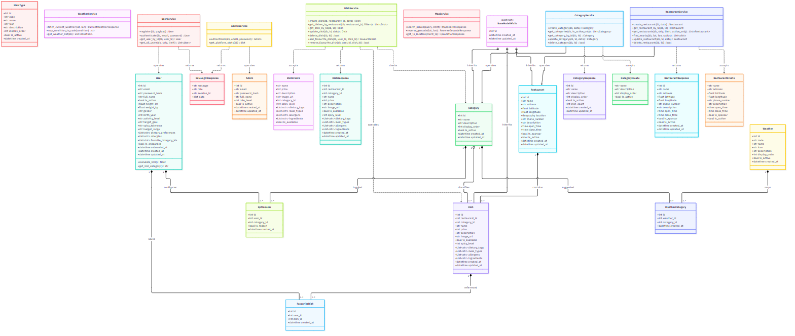

# Sơ đồ Lớp Hệ thống (UML Class Diagram) - PTC1

Tài liệu này lưu trữ toàn bộ thiết kế hướng đối tượng (Object-Oriented Design), **Sơ đồ Lớp Hệ thống (UML Class Diagram 2.5)**, từ điển thuộc tính & phương thức (Class Dictionary) bám sát **100% mã nguồn thực tế** tại thư mục `server/app/`.

---

## 1. Tổng quan Thiết kế

- **Chuẩn UML 2.5 Quốc tế:** Sử dụng đúng cú pháp và biểu tượng UML Class Diagram (`classDiagram`), bao gồm:
  - **Tên lớp (PascalCase):** `User`, `Admin`, `Restaurant`, `Category`, `Dish`, `UserService`, `DishService`...
  - **Ký hiệu phạm vi truy cập (Visibility):** `+` (public), `-` (private), `#` (protected).
  - **Kế thừa / Khái quát hóa (Generalization):** `BaseModelMixin <|-- Restaurant`, `BaseModelMixin <|-- Category`, `BaseModelMixin <|-- Dish`.
  - **Kết hợp & Chứa đựng (Composition / Aggregation):** `Restaurant "1" *-- "0..*" Dish`, `Category "1" o-- "0..*" Dish`.
  - **Phụ thuộc nghiệp vụ (Dependency):** `DishService ..> Dish`, `UserService ..> RoleLoginResponse`.
- **Phân tách 3 tầng kiến trúc:**
  1. **Domain Models (SQLAlchemy ORM):** Ánh xạ bảng quan hệ và kiểu không gian PostGIS (`GEOGRAPHY(POINT, 4326)`).
  2. **Service Layer:** Logic nghiệp vụ, validation và điều phối cơ sở dữ liệu.
  3. **Schemas & DTOs (Pydantic v2):** Hợp đồng dữ liệu API request và response.
- **Xác thực phiên (Session Management):** Phản hồi đăng nhập qua `RoleLoginResponse` với mã phiên ngẫu nhiên `session_id` (UUID4 hex 32 ký tự).

---

## 2. Sơ đồ Lớp Hệ thống (UML Class Diagram)

> 💡 *Bạn có thể xem bản vẽ vector sắc nét, phóng to không vỡ nét tại [class-diagram.svg](class-diagram.svg)*

```mermaid
classDiagram
    direction TB

    class BaseModelMixin {
        <<abstract>>
        +int id
        +datetime created_at
        +datetime updated_at
    }

    class User {
        +int id
        +str email
        +str password_hash
        +str full_name
        +bool is_active
        +float height_cm
        +float weight_kg
        +str gender
        +int birth_year
        +str activity_level
        +str target_goal
        +str spicy_tolerance
        +str budget_range
        +List~str~ dietary_preferences
        +List~str~ allergies
        +List~int~ favorite_category_ids
        +bool is_onboarded
        +datetime onboarded_at
        +datetime created_at
        +datetime updated_at
        +calculate_bmi() float
        +get_bmi_category() str
    }

    class Admin {
        +int id
        +str email
        +str password_hash
        +str full_name
        +int role_level
        +bool is_active
        +datetime created_at
        +datetime updated_at
    }

    class Restaurant {
        +int id
        +str name
        +str address
        +float latitude
        +float longitude
        +Geography location
        +str phone_number
        +str description
        +time open_time
        +time close_time
        +bool is_sponsor
        +bool is_active
        +datetime created_at
        +datetime updated_at
    }

    class Category {
        +int id
        +str name
        +str description
        +int display_order
        +bool is_active
        +datetime created_at
        +datetime updated_at
    }

    class Dish {
        +int id
        +int restaurant_id
        +int category_id
        +str name
        +int price
        +str description
        +str image_url
        +bool is_available
        +int spicy_level
        +List~str~ dietary_tags
        +List~str~ meal_types
        +List~str~ allergens
        +List~str~ ingredients
        +datetime created_at
        +datetime updated_at
    }

    class MealType {
        +int id
        +str code
        +str name
        +str icon
        +str description
        +int display_order
        +bool is_active
        +datetime created_at
    }

    class Weather {
        +int id
        +str code
        +str name
        +str icon
        +str description
        +int display_order
        +bool is_active
        +datetime created_at
    }

    class WeatherCategory {
        +int id
        +int weather_id
        +int category_id
        +datetime created_at
    }

    class OptionUser {
        +int id
        +int user_id
        +int category_id
        +bool is_hidden
        +datetime created_at
    }

    class FavouriteDish {
        +int id
        +int user_id
        +int dish_id
        +datetime created_at
    }

    class RoleLoginResponse {
        +str message
        +str role
        +str session_id
        +dict data
    }

    class DishCreate {
        +str name
        +int price
        +str description
        +str image_url
        +int category_id
        +int spicy_level
        +List~str~ dietary_tags
        +List~str~ meal_types
        +List~str~ allergens
        +List~str~ ingredients
        +bool is_available
    }

    class DishResponse {
        +int id
        +int restaurant_id
        +int category_id
        +str name
        +int price
        +str description
        +str image_url
        +bool is_available
        +int spicy_level
        +List~str~ dietary_tags
        +List~str~ meal_types
        +List~str~ allergens
        +List~str~ ingredients
        +datetime created_at
        +datetime updated_at
    }

    class RestaurantCreate {
        +str name
        +str address
        +float latitude
        +float longitude
        +str phone_number
        +str description
        +time open_time
        +time close_time
        +bool is_sponsor
        +bool is_active
    }

    class RestaurantResponse {
        +int id
        +str name
        +str address
        +float latitude
        +float longitude
        +str phone_number
        +str description
        +time open_time
        +time close_time
        +bool is_sponsor
        +bool is_active
        +datetime created_at
        +datetime updated_at
    }

    class CategoryCreate {
        +str name
        +str description
        +int display_order
        +bool is_active
    }

    class CategoryResponse {
        +int id
        +str name
        +str description
        +int display_order
        +bool is_active
        +int dish_count
        +datetime created_at
        +datetime updated_at
    }

    class UserService {
        +register(db, payload) User
        +authenticate(db, email, password) User
        +get_user_by_id(db, user_id) User
        +get_all_users(db, skip, limit) List~User~
    }

    class AdminService {
        +authenticate(db, email, password) Admin
        +get_platform_stats(db) dict
    }

    class RestaurantService {
        +create_restaurant(db, data) Restaurant
        +get_restaurant_by_id(db, id) Restaurant
        +get_restaurants(db, skip, limit, active_only) List~Restaurant~
        +find_nearby(db, lat, lon, radius) List~dict~
        +update_restaurant(db, id, data) Restaurant
        +delete_restaurant(db, id) bool
    }

    class DishService {
        +create_dish(db, restaurant_id, data) Dish
        +get_dishes_by_restaurant(db, restaurant_id, filters) List~Dish~
        +get_dish_by_id(db, id) Dish
        +update_dish(db, id, data) Dish
        +delete_dish(db, id) bool
        +add_favourite_dish(db, user_id, dish_id) FavouriteDish
        +remove_favourite_dish(db, user_id, dish_id) bool
    }

    class CategoryService {
        +create_category(db, data) Category
        +get_categories(db, is_active_only) List~Category~
        +get_category_by_id(db, id) Category
        +update_category(db, id, data) Category
        +delete_category(db, id) bool
    }

    class MapService {
        +search_places(query, limit) MapSearchResponse
        +reverse_geocode(lat, lon) ReverseGeocodeResponse
        +get_ip_location(client_ip) IpLocationResponse
    }

    class WeatherService {
        +fetch_current_weather(lat, lon) CurrentWeatherResponse
        +map_condition_to_code(condition) str
        +get_weather_list(db) List~Weather~
    }

    BaseModelMixin <|-- Restaurant : inherits
    BaseModelMixin <|-- Category : inherits
    BaseModelMixin <|-- Dish : inherits

    Restaurant "1" *-- "0..*" Dish : contains
    Category "1" o-- "0..*" Dish : classifies
    User "1" *-- "0..*" FavouriteDish : saves
    Dish "1" *-- "0..*" FavouriteDish : referenced
    User "1" *-- "0..*" OptionUser : configures
    Category "1" *-- "0..*" OptionUser : toggled
    Weather "1" *-- "0..*" WeatherCategory : maps
    Category "1" *-- "0..*" WeatherCategory : suggested

    UserService ..> User : operates
    UserService ..> RoleLoginResponse : returns
    AdminService ..> Admin : operates
    AdminService ..> RoleLoginResponse : returns
    RestaurantService ..> Restaurant : operates
    RestaurantService ..> RestaurantCreate : accepts
    RestaurantService ..> RestaurantResponse : returns
    DishService ..> Dish : operates
    DishService ..> Category : checks
    DishService ..> DishCreate : accepts
    DishService ..> DishResponse : returns
    CategoryService ..> Category : operates
    CategoryService ..> CategoryCreate : accepts
    CategoryService ..> CategoryResponse : returns
```

<b>Nhấn vào đây để xem mã nguồn sơ đồ (Mermaid code)</b>

---

## 3. Đặc Tả Chi Tiết Từng Lớp (Class Specifications)

### 3.1. Lớp Thực thể Domain Models

#### `User` (`server/app/models/user.py`)
- **Vai trò:** Thực khách / Khách hàng sử dụng ứng dụng di động. Tích hợp chỉ số thể chất và khảo sát Onboarding.
- **Thuộc tính:**
  - `+id: int`: Định danh duy nhất (Primary Key).
  - `+email: str`: Email đăng nhập (Unique Index).
  - `+password_hash: str`: Mật khẩu băm an toàn PBKDF2-HMAC-SHA256 (100.000 rounds).
  - `+full_name: str`: Họ và tên người dùng.
  - `+is_active: bool`: Cờ trạng thái kích hoạt tài khoản.
  - `+height_cm: float`: Chiều cao cơ thể (cm).
  - `+weight_kg: float`: Cân nặng cơ thể (kg).
  - `+gender: str`: Giới tính (`male`, `female`, `other`).
  - `+birth_year: int`: Năm sinh.
  - `+activity_level: str`: Mức độ vận động (`sedentary`, `light`, `active`).
  - `+target_goal: str`: Mục tiêu vóc dáng (`maintain`, `lose_weight`, `gain_muscle`).
  - `+spicy_tolerance: str`: Khẩu vị cay (`none`, `mild`, `medium`, `hot`).
  - `+budget_range: str`: Khung chi tiêu (`budget`, `moderate`, `premium`).
  - `+dietary_preferences: List[str]`: Mảng chế độ ăn kiêng (`vegetarian`, `vegan`, `halal`, `keto`...).
  - `+allergies: List[str]`: Mảng chất gây dị ứng (`peanut`, `seafood`, `dairy`, `egg`...).
  - `+favorite_category_ids: List[int]`: Mảng ID danh mục món ăn ưa thích.
  - `+is_onboarded: bool`: Đã hoàn tất khảo sát hồ sơ ẩm thực.
  - `+onboarded_at: datetime`: Thời điểm hoàn thành khảo sát.
  - `+created_at, updated_at: datetime`: Dấu thời gian hệ thống.
- **Phương thức nghiệp vụ:**
  - `+calculate_bmi() -> float`: Tự động tính chỉ số khối cơ thể: $	ext{BMI} = 	ext{weight} / (	ext{height}/100)^2$.
  - `+get_bmi_category() -> str`: Phân loại thể trạng: *Gầy* ($< 18.5$), *Bình thường* ($18.5 - 24.9$), *Thừa cân* ($\ge 25$).

#### `Restaurant` (`server/app/models/restaurant.py`)
- **Vai trò:** Quán ăn ẩm thực trên hệ thống. Hỗ trợ dữ liệu không gian PostGIS và nhãn Nhà tài trợ.
- **Kế thừa:** `BaseModelMixin` (`id`, `created_at`, `updated_at`).
- **Thuộc tính:**
  - `+name: str`: Tên quán ăn.
  - `+address: str`: Địa chỉ đường phố.
  - `+latitude: float, +longitude: float`: Tọa độ địa lý WGS84.
  - `+location: Geography`: Điểm hình học PostGIS `POINT(SRID 4326)` có GiST Index phục vụ truy vấn `ST_DWithin` và `ST_Distance`.
  - `+phone_number: str`: Hotline liên hệ.
  - `+description: str`: Giới thiệu quán ăn.
  - `+open_time, close_time: time`: Giờ mở cửa và đóng cửa (`HH:MM`).
  - `+is_sponsor: bool`: **Cờ Nhà tài trợ:** Quán được ưu tiên hiển thị lên đầu kết quả tìm kiếm.
  - `+is_active: bool`: Trạng thái hoạt động.

#### `Category` (`server/app/models/category.py`)
- **Vai trò:** Nhóm danh mục món ăn toàn cục (Global Categories).
- **Kế thừa:** `BaseModelMixin`.
- **Đặc điểm kiến trúc:** Không chứa `restaurant_id`, được tạo bởi Quản trị viên và dùng chung cho toàn bộ quán ăn trên hệ thống. Ràng buộc `lower(name)` duy nhất toàn cầu.

#### `Dish` (`server/app/models/dish.py`)
- **Vai trò:** Món ăn trong thực đơn của quán ăn.
- **Kế thừa:** `BaseModelMixin`.
- **Thuộc tính:**
  - `+restaurant_id: int`: Thuộc về quán ăn (Khóa ngoại `restaurants.id`, `ON DELETE CASCADE`).
  - `+category_id: int`: Thuộc về danh mục toàn cục (Khóa ngoại Nullable `categories.id`, `ON DELETE SET NULL`).
  - `+name: str`: Tên món ăn.
  - `+price: int`: Giá bán ($\ge 0$ VNĐ).
  - `+spicy_level: int`: Độ cay ($0$: không cay, $1$: cay nhẹ, $2$: cay vừa, $3$: rất cay).
  - `+dietary_tags: List[str]`: Mảng chế độ ăn kiêng (Postgres `ARRAY(Text)`).
  - `+meal_types: List[str]`: Mảng bữa ăn phù hợp (`breakfast`, `lunch`, `dinner`, `snack`, `all_day`).
  - `+allergens: List[str]`: Mảng cảnh báo chất dị ứng (`peanut`, `seafood`, `dairy`, `egg`...).
  - `+ingredients: List[str]`: Mảng nguyên liệu món ăn.
  - `+is_available: bool`: Tình trạng sẵn sàng phục vụ.

---

### 3.2. Lớp Dịch vụ Nghiệp vụ (Service Layer)

- **`UserService`:** Đăng ký tài khoản mới kèm băm PBKDF2 muối ngẫu nhiên; xác thực đăng nhập; lấy thông tin người dùng.
- **`RestaurantService`:** Thêm, sửa, xóa quán ăn; tìm kiếm lân cận qua hàm không gian PostGIS `ST_DWithin` và sắp xếp theo `ST_Distance`.
- **`DishService`:** Thêm món ăn mới với mảng nhãn đa chiều; tìm kiếm và lọc món ăn đa tiêu chí (`category_id`, `spicy_level`, `meal_type`, `dietary_tag`, `ingredient`); quản lý món ăn yêu thích Idempotent.
- **`CategoryService`:** Quản lý danh mục toàn cục, kiểm tra trùng tên không phân biệt hoa thường, dọn dẹp khóa ngoại SET NULL khi xóa.
- **`MapService`:** Định vị trực tuyến qua IP (Zero GPS permission); Geocoding chuyển đổi địa chỉ qua OpenStreetMap Nominatim.
- **`WeatherService`:** Tích hợp OpenWeatherMap API, ánh xạ điều kiện khí hậu về 4 mã chuẩn (`rainy`, `cold`, `hot`, `mild`) và truy vấn danh mục món ăn gợi ý tương ứng.

---

### 3.3. Lớp Đối tượng Truyền Dữ liệu (Schemas / DTOs)

- **`RoleLoginResponse`:** Phản hồi đăng nhập hợp nhất cho cả User và Admin:
  - `+message: str = "Login successful"`
  - `+role: str = "user" | "admin"`
  - `+session_id: str`: **Mã phiên ngẫu nhiên (UUID4 hex 32 ký tự)** giúp quản lý phiên làm việc chính xác và bảo mật.
  - `+data: dict`: Dữ liệu tài khoản chi tiết.
- **`DishCreate` & `DishResponse`:** DTO đầu vào và đầu ra cho món ăn với đầy đủ các mảng thuộc tính phân loại.
- **`RestaurantCreate` & `RestaurantResponse`:** DTO quản trị quán ăn kèm cờ `is_sponsor`.
