# Sơ đồ Lớp Hệ thống (UML Class Diagram) - PTC1

Tài liệu này mô tả chi tiết kiến trúc hướng đối tượng (Object-Oriented Design) và **Sơ đồ Lớp (UML Class Diagram)** chuẩn UML 2.5 của hệ sinh thái **PTC1**, phản ánh chính xác 100% cấu trúc mã nguồn thực tế tại thư mục `server/app/`.

---

## 1. Tổng quan Kiến trúc Phần mềm

Hệ thống backend PTC1 được thiết kế theo mô hình phân tầng chặt chẽ (**Layered Architecture**):
1. **Tầng Thực thể Cơ sở dữ liệu (Domain Models - SQLAlchemy ORM):** Ánh xạ trực tiếp tới các bảng quan hệ trong PostgreSQL 14 và trường hình học PostGIS (`GEOGRAPHY(POINT, 4326)`).
2. **Tầng Xử lý Nghiệp vụ (Service Layer):** Đóng gói toàn bộ logic nghiệp vụ, xác thực toàn vẹn dữ liệu, các phép tính toán không gian và điều phối tương tác cơ sở dữ liệu.
3. **Tầng Biểu diễn Dữ liệu & Hợp đồng API (Schemas / DTOs - Pydantic v2):** Định nghĩa cấu trúc dữ liệu đầu vào (Input Request) và đầu ra (Output Response), thực thi xác thực kiểu dữ liệu nghiêm ngặt.

> 💡 *Bạn có thể xem bản vẽ vector SVG sắc nét phóng to không vỡ nét tại [class-diagram.svg](class-diagram.svg)*

---

## 2. Sơ đồ Lớp Chi tiết (Mermaid UML Class Diagram)

```mermaid
classDiagram
    direction TB

    %% ==========================================
    %% NAMESPACE: DOMAIN MODELS (SQLAlchemy ORM)
    %% ==========================================
    class BaseModelMixin {
        <<abstract>>
        +int id
        +datetime created_at
        +datetime updated_at
    }

    class User {
        +int id
        +str email
        +str password_hash
        +str full_name
        +bool is_active
        +float height_cm
        +float weight_kg
        +str gender
        +int birth_year
        +str activity_level
        +str target_goal
        +List~int~ favorite_category_ids
        +List~str~ dietary_preferences
        +str spicy_tolerance
        +List~str~ allergies
        +str budget_range
        +bool is_onboarded
        +datetime onboarded_at
        +datetime created_at
        +datetime updated_at
        +calculate_bmi() float
        +get_bmi_category() str
    }

    class Admin {
        +int id
        +str email
        +str password_hash
        +str full_name
        +int role_level
        +bool is_active
        +datetime created_at
        +datetime updated_at
    }

    class Restaurant {
        +int id
        +str name
        +str address
        +float latitude
        +float longitude
        +Geography location
        +str phone_number
        +str description
        +time open_time
        +time close_time
        +bool is_active
        +bool is_sponsor
        +datetime created_at
        +datetime updated_at
    }

    class Category {
        +int id
        +str name
        +str description
        +int display_order
        +bool is_active
        +datetime created_at
        +datetime updated_at
    }

    class Dish {
        +int id
        +int restaurant_id
        +int category_id
        +str name
        +int price
        +str description
        +str image_url
        +bool is_available
        +int spicy_level
        +List~str~ dietary_tags
        +List~str~ meal_types
        +List~str~ allergens
        +List~str~ ingredients
        +datetime created_at
        +datetime updated_at
    }

    class MealType {
        +int id
        +str code
        +str name
        +str icon
        +str description
        +int display_order
    }

    class Weather {
        +int id
        +str code
        +str name
        +str icon
        +str description
        +int display_order
    }

    class WeatherCategory {
        +int weather_id
        +int category_id
    }

    class OptionUser {
        +int id
        +int user_id
        +int category_id
        +bool is_hidden
        +datetime created_at
    }

    class FavouriteDish {
        +int id
        +int user_id
        +int dish_id
        +datetime created_at
    }

    %% Kế thừa & Quan hệ Model
    BaseModelMixin <|-- Restaurant
    BaseModelMixin <|-- Category
    BaseModelMixin <|-- Dish
    Restaurant "1" *-- "0..*" Dish : contains
    Category "1" o-- "0..*" Dish : classifies
    User "1" *-- "0..*" FavouriteDish : saves
    Dish "1" *-- "0..*" FavouriteDish : referenced
    User "1" *-- "0..*" OptionUser : preferences
    Category "1" *-- "0..*" OptionUser : toggled
    Weather "1" *-- "0..*" WeatherCategory : maps
    Category "1" *-- "0..*" WeatherCategory : mapped

    %% ==========================================
    %% NAMESPACE: SERVICE LAYER
    %% ==========================================
    class UserService {
        +authenticate(db, email, password) User
        +register(db, payload) User
        +get_user_by_id(db, user_id) User
        +get_all_users(db, skip, limit) List~User~
    }

    class AdminService {
        +authenticate(db, email, password) Admin
        +get_platform_stats(db) dict
        +get_admin_by_id(db, admin_id) Admin
    }

    class RestaurantService {
        +create_restaurant(db, payload) Restaurant
        +get_restaurant_by_id(db, id) Restaurant
        +get_restaurants(db, skip, limit, active_only) List~Restaurant~
        +find_nearby(db, lat, lon, radius) List~dict~
        +update_restaurant(db, id, payload) Restaurant
        +delete_restaurant(db, id) bool
    }

    class DishService {
        +create_dish(db, restaurant_id, payload) Dish
        +get_dishes_by_restaurant(db, restaurant_id, ...) List~Dish~
        +get_dish_by_id(db, id) Dish
        +update_dish(db, id, payload) Dish
        +delete_dish(db, id) bool
        +add_favourite_dish(db, user_id, dish_id) FavouriteDish
        +remove_favourite_dish(db, user_id, dish_id) bool
    }

    class CategoryService {
        +create_category(db, payload) Category
        +get_categories(db, is_active_only) List~Category~
        +get_category_by_id(db, id) Category
        +update_category(db, id, payload) Category
        +delete_category(db, id) bool
    }

    class MapService {
        +search_places(query, limit) MapSearchResponse
        +reverse_geocode(lat, lon) ReverseGeocodeResponse
        +get_ip_location(client_ip) IpLocationResponse
    }

    class WeatherService {
        +fetch_current_weather(lat, lon) CurrentWeatherResponse
        +get_weather_list(db) List~Weather~
    }

    %% Service Phụ thuộc Models
    UserService ..> User : manages
    AdminService ..> Admin : manages
    RestaurantService ..> Restaurant : manages
    DishService ..> Dish : manages
    DishService ..> Category : checks
    CategoryService ..> Category : manages
    WeatherService ..> WeatherCategory : reads

    %% ==========================================
    %% NAMESPACE: SCHEMAS & DTOS (Pydantic v2)
    %% ==========================================
    class RoleLoginResponse {
        +str message
        +str role
        +str session_id
        +dict data
    }

    class DishCreate {
        +str name
        +int price
        +str description
        +str image_url
        +int category_id
        +int spicy_level
        +List~str~ dietary_tags
        +List~str~ meal_types
        +List~str~ allergens
        +List~str~ ingredients
        +bool is_available
    }

    class DishResponse {
        +int id
        +int restaurant_id
        +int category_id
        +str name
        +int price
        +str description
        +str image_url
        +bool is_available
        +int spicy_level
        +List~str~ dietary_tags
        +List~str~ meal_types
        +List~str~ allergens
        +List~str~ ingredients
        +datetime created_at
        +datetime updated_at
    }

    class RestaurantCreate {
        +str name
        +str address
        +float latitude
        +float longitude
        +str phone_number
        +str description
        +time open_time
        +time close_time
        +bool is_active
        +bool is_sponsor
    }

    class RestaurantResponse {
        +int id
        +str name
        +str address
        +float latitude
        +float longitude
        +str phone_number
        +str description
        +time open_time
        +time close_time
        +bool is_active
        +bool is_sponsor
        +datetime created_at
        +datetime updated_at
    }

    class CategoryCreate {
        +str name
        +str description
        +int display_order
        +bool is_active
    }

    class CategoryResponse {
        +int id
        +str name
        +str description
        +int display_order
        +bool is_active
        +int dish_count
        +datetime created_at
        +datetime updated_at
    }

    class UserProfileResponse {
        +int id
        +str email
        +str full_name
        +float height_cm
        +float weight_kg
        +float bmi
        +str bmi_category
        +str target_goal
        +str spicy_tolerance
        +str budget_range
        +List~str~ dietary_preferences
        +List~str~ allergies
        +bool is_onboarded
    }

    %% DTO Phụ thuộc Services & Models
    DishService ..> DishCreate : accepts
    DishService ..> DishResponse : returns
    RestaurantService ..> RestaurantCreate : accepts
    RestaurantService ..> RestaurantResponse : returns
    CategoryService ..> CategoryCreate : accepts
    CategoryService ..> CategoryResponse : returns
    UserService ..> RoleLoginResponse : returns
    AdminService ..> RoleLoginResponse : returns
```

<b>Nhấn vào đây để xem mã nguồn sơ đồ Mermaid</b>

---

## 3. Diễn giải Chi tiết các Mối quan hệ UML

### 3.1. Tầng Thực thể Dữ liệu (Domain Models)
* **`Restaurant` 1 -- 0..* `Dish` (Composition / Aggregate):**
  - Một quán ăn sở hữu nhiều món ăn trong thực đơn.
  - Khi một quán ăn bị xoá (`DELETE /restaurants/{id}`), toàn bộ món ăn thuộc quán đó sẽ tự động bị xoá theo thông qua cơ chế `ON DELETE CASCADE`.
* **`Category` 1 -- 0..* `Dish` (Loose Association / Nullable):**
  - **Category đã được chuyển thành Danh mục toàn cục (Global Category):** Bảng `categories` hoàn toàn không còn trường `restaurant_id`. Danh mục được tạo bởi Quản trị viên và dùng chung trên toàn hệ thống.
  - Cột `dishes.category_id` là khoá ngoại Nullable. Khi Quản trị viên xoá một danh mục, các món ăn thuộc danh mục đó sẽ được tự động gán về `NULL` (`ON DELETE SET NULL`), bảo toàn dữ liệu món ăn trong thực đơn của quán.
* **`Dish` đa chiều phân loại:**
  - Bỏ 2 cột đơn `meal_type` và `meal_type_id`.
  - Thay thế bằng các mảng Postgres đa giá trị: `meal_types: List[str]`, `dietary_tags: List[str]`, `allergens: List[str]`, `ingredients: List[str]`, và chỉ số độ cay `spicy_level: int (0..3)`.
* **`Restaurant` hỗ trợ ưu tiên tài trợ (`is_sponsor`):**
  - Trường boolean `is_sponsor` (mặc định `false`) đánh dấu các quán ăn nhà tài trợ được ưu tiên nổi bật trên ứng dụng thực khách.
* **`User` và Hồ sơ Sức khỏe / Khảo sát Onboarding:**
  - Tích hợp trực tiếp các chỉ số thể chất (`height_cm`, `weight_kg`), khẩu vị (`spicy_tolerance`), ngân sách (`budget_range`), mục tiêu (`target_goal`), chế độ ăn (`dietary_preferences`), dị ứng (`allergens`) và tính toán BMI động.

### 3.2. Tầng Nghiệp vụ (Service Layer) & Xác thực Phiên
* **`UserService` & `AdminService` trả về `RoleLoginResponse`:**
  - Đăng nhập xác thực mật khẩu qua thuật toán băm PBKDF2-HMAC-SHA256 (100.000 rounds).
  - Phản hồi chứa mã định danh phiên làm việc **`session_id`** (UUID4 hex ngẫu nhiên) thay vì JWT Token vô trạng thái, khớp 100% với cơ chế quản lý phiên hiện tại của hệ sinh thái PTC1.
* **`DishService` & `CategoryService`:**
  - Kiểm tra tính duy nhất của tên danh mục trên phạm vi toàn cầu (`lower(name)`).
  - Tạo món ăn liên kết trực tiếp vào quán ăn mà không còn ràng buộc đối chiếu danh mục theo quán.

---

## 4. Bảng Tra cứu Đối chiếu Mã nguồn (Source Code Traceability)

| Lớp UML (Class) | File Mã Nguồn Thực tế | Vai trò trong Hệ thống |
| :--- | :--- | :--- |
| `Restaurant` | [`server/app/models/restaurant.py`](../server/app/models/restaurant.py) | Model quán ăn, toạ độ WGS84, cờ `is_sponsor` |
| `Category` | [`server/app/models/category.py`](../server/app/models/category.py) | Model danh mục toàn cục (Global Categories) |
| `Dish` | [`server/app/models/dish.py`](../server/app/models/dish.py) | Model món ăn đa nhãn (spicy, meal_types, allergens...) |
| `User` | [`server/app/models/user.py`](../server/app/models/user.py) | Model khách hàng & hồ sơ thể chất / onboarding |
| `Admin` | [`server/app/models/admin.py`](../server/app/models/admin.py) | Model quản trị viên hệ thống (`role_level`) |
| `MealType` | [`server/app/models/meal_type.py`](../server/app/models/meal_type.py) | Model danh mục bữa ăn tham chiếu |
| `Weather` | [`server/app/models/weather.py`](../server/app/models/weather.py) | Model danh mục thời tiết tham chiếu |
| `WeatherCategory` | [`server/app/models/weather_category.py`](../server/app/models/weather_category.py) | Bảng quan hệ N-N giữa Thời tiết & Danh mục món |
| `OptionUser` | [`server/app/models/option_user.py`](../server/app/models/option_user.py) | Tuỳ chọn ẩn/hiện danh mục theo cá nhân User |
| `FavouriteDish` | [`server/app/models/favourite_dish.py`](../server/app/models/favourite_dish.py) | Danh sách món ăn yêu thích của thực khách |
| `RoleLoginResponse` | [`server/app/schemas/common.py`](../server/app/schemas/common.py) | Schema phản hồi đăng nhập chứa `session_id` |
| `DishService` | [`server/app/services/dish_service.py`](../server/app/services/dish_service.py) | Xử lý thực đơn, tìm kiếm đa tiêu chí & yêu thích |
| `CategoryService` | [`server/app/services/category_service.py`](../server/app/services/category_service.py) | Xử lý danh mục toàn cục |
| `RestaurantService` | [`server/app/services/restaurant_service.py`](../server/app/services/restaurant_service.py) | Quản lý quán ăn và tìm kiếm lân cận PostGIS |
| `MapService` | [`server/app/services/map_service.py`](../server/app/services/map_service.py) | Định vị IP, Geocoding OpenStreetMap |
