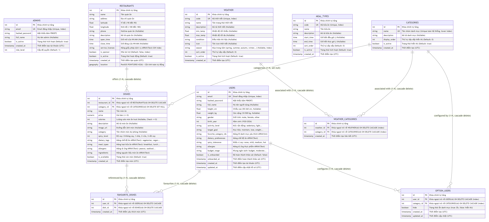

# Thiết kế Cơ sở Dữ liệu (Database Design & Schema) - PTC1

Tài liệu này lưu trữ toàn bộ thiết kế kiến trúc cơ sở dữ liệu, sơ đồ ERD, từ điển dữ liệu (Data Dictionary), các ràng buộc toàn vẹn và mã SQL DDL khởi tạo của hệ thống PTC1 dựa trên mã nguồn hiện hữu tại `server/app/models/`.

---

## 1. Tổng quan Thiết kế

- **Hệ quản trị CSDL:** PostgreSQL 14 (chuẩn hóa quốc tế).
- **Phần mở rộng không gian địa lý:** PostGIS 3.6.1 (hỗ trợ kiểu dữ liệu `GEOGRAPHY(POINT, 4326)` và các hàm tính toán khoảng cách cầu, tìm kiếm lân cận `ST_DWithin`, `ST_Distance`).
- **Mô hình tài khoản (Role Separation):** Phân chia 2 bảng tài khoản độc lập (`users`, `admins`) dùng chung cấu trúc xác thực qua mixin, giúp tối ưu hóa nghiệp vụ riêng của từng đối tượng và đảm bảo an toàn phân quyền ở tầng dữ liệu.
- **Khách vãng lai (Guest):** Không lưu trữ thông tin trong DB, chỉ truy vấn dữ liệu công khai.

---

## 2. Sơ đồ Thực thể Liên kết (ERD)



> 💡 *Bạn có thể xem bản vẽ vector sắc nét tại [erd-diagram.svg](erd-diagram.svg)*

```mermaid
erDiagram
    USERS {
        int id PK "Khóa chính tự tăng"
        string email UK "Email đăng nhập (Unique, Index)"
        string hashed_password "Mật khẩu băm PBKDF2"
        string full_name "Họ tên người dùng (Nullable)"
        float height_cm "Chiều cao (50-260 cm, Nullable)"
        float weight_kg "Cân nặng (10-500 kg, Nullable)"
        string gender "Giới tính: male, female, other"
        int birth_year "Năm sinh (1920-2026)"
        string activity_level "Mức vận động: sedentary, light..."
        string target_goal "Mục tiêu: maintain, lose_weight..."
        string favorite_category_ids "Mảng ID danh mục yêu thích ARRAY(Int)"
        string dietary_preferences "Mảng chế độ ăn ARRAY(Text)"
        string spicy_tolerance "Khẩu vị cay: none, mild, medium, hot"
        string allergies "Mảng dị ứng thực phẩm ARRAY(Text)"
        string budget_range "Khung ngân sách: budget, moderate..."
        boolean is_onboarded "Đã hoàn thành khảo sát (Default: false)"
        timestamp onboarded_at "Thời điểm hoàn thành khảo sát (UTC)"
        timestamp created_at "Thời điểm tạo tài khoản (UTC)"
        timestamp updated_at "Thời điểm cập nhật hồ sơ (UTC)"
    }

    ADMINS {
        int id PK "Khóa chính tự tăng"
        string email UK "Email đăng nhập (Unique, Index)"
        string hashed_password "Mật khẩu băm PBKDF2"
        string full_name "Họ tên admin (Nullable)"
        boolean is_active "Trạng thái kích hoạt (Default: true)"
        timestamp created_at "Thời điểm tạo tài khoản (UTC)"
        int role_level "Cấp độ quyền (Default: 1)"
    }

    RESTAURANTS ||--o{ DISHES : "offers (1-N, cascade delete)"
    RESTAURANTS {
        int id PK "Khóa chính tự tăng"
        string name "Tên quán ăn"
        string address "Địa chỉ quán ăn"
        float latitude "Vĩ độ (-90 đến 90)"
        float longitude "Kinh độ (-180 đến 180)"
        string phone "Hotline quán ăn (Nullable)"
        string description "Mô tả quán ăn (Nullable)"
        time open_time "Giờ mở cửa HH:MM (Nullable)"
        time close_time "Giờ đóng cửa HH:MM (Nullable)"
        string service_licenses "Mảng giấy phép dịch vụ ARRAY(Text) GIN index"
        boolean is_sponsor "Nhà tài trợ (Default: false, Index)"
        boolean is_active "Trạng thái hoạt động (Default: true)"
        timestamp created_at "Thời điểm tạo quán (UTC)"
        geography location "PostGIS POINT(SRID 4326) - Cột tính toán tự động"
    }

    CATEGORIES ||--o{ DISHES : "categorizes (1-N, set null)"
    CATEGORIES {
        int id PK "Khóa chính tự tăng"
        string name UK "Tên nhóm danh mục (Unique toàn hệ thống, lower index)"
        string description "Mô tả danh mục (Nullable)"
        int display_order "Thứ tự sắp xếp hiển thị (Default: 0)"
        boolean is_active "Trạng thái hiển thị (Default: true)"
        timestamp created_at "Thời điểm tạo (UTC)"
    }

    MEAL_TYPES {
        int id PK "Khóa chính tự tăng"
        string code UK "Mã bữa ăn (Unique, Index)"
        string name "Tên bữa ăn"
        string description "Mô tả bữa ăn (Nullable)"
        time start_time "Giờ bắt đầu gợi ý (Nullable)"
        time end_time "Giờ kết thúc gợi ý (Nullable)"
        int sort_order "Thứ tự sắp xếp (Default: 0)"
        boolean is_active "Trạng thái kích hoạt (Default: true)"
        timestamp created_at "Thời điểm tạo (UTC)"
    }

    WEATHER {
        int id PK "Khóa chính tự tăng"
        string code UK "Mã thời tiết (Unique, Index)"
        string name "Tên trạng thái thời tiết"
        string description "Mô tả thời tiết (Nullable)"
        float min_temp "Nhiệt độ tối thiểu (Nullable)"
        float max_temp "Nhiệt độ tối đa (Nullable)"
        string condition "Điều kiện khí hậu (Nullable)"
        string icon "Tên icon thời tiết (Nullable)"
        string season "Mùa trong năm (spring, summer, autumn, winter...) (Nullable, Index)"
        int sort_order "Thứ tự sắp xếp (Default: 0)"
        boolean is_active "Trạng thái kích hoạt (Default: true)"
        timestamp created_at "Thời điểm tạo (UTC)"
    }

    DISHES ||--o{ FAVOURITE_DISHES : "referenced by (1-N, cascade delete)"
    DISHES {
        int id PK "Khóa chính tự tăng"
        int restaurant_id FK "Khóa ngoại trỏ về RESTAURANTS(id) ON DELETE CASCADE"
        int category_id FK "Khóa ngoại trỏ về CATEGORIES(id) ON DELETE SET NULL"
        string name "Tên món ăn"
        numeric price "Giá bán (>= 0)"
        int calories "Lượng calo món ăn kcal (Nullable, Check >= 0)"
        string description "Mô tả món ăn (Nullable)"
        string image_url "Đường dẫn ảnh món (Nullable)"
        string category "Tên nhóm món dự phòng (Nullable)"
        int spicy_level "Độ cay: 0-không cay, 1-nhẹ, 2-vừa, 3-rất cay"
        string dietary_tags "Mảng chế độ ăn ARRAY(Text): vegetarian, vegan..."
        string meal_types "Mảng loại bữa ăn ARRAY(Text): breakfast, lunch..."
        string allergens "Mảng dị ứng ARRAY(Text): peanut, seafood..."
        string ingredients "Mảng nguyên liệu món ăn ARRAY(Text)"
        boolean is_available "Trạng thái còn món (Default: true)"
        timestamp created_at "Thời điểm tạo món (UTC)"
    }

    USERS ||--o{ FAVOURITE_DISHES : "favourites (1-N, cascade delete)"
    USERS ||--o{ OPTION_USERS : "configures (1-N, cascade delete)"
    CATEGORIES ||--o{ OPTION_USERS : "configured by (1-N, cascade delete)"
    WEATHER ||--o{ WEATHER_CATEGORIES : "associated with (1-N, cascade delete)"
    CATEGORIES ||--o{ WEATHER_CATEGORIES : "associated with (1-N, cascade delete)"
    WEATHER_CATEGORIES {
        int id PK "Khóa chính tự tăng"
        int weather_id FK "Khóa ngoại trỏ về WEATHER(id) ON DELETE CASCADE (Index)"
        int category_id FK "Khóa ngoại trỏ về CATEGORIES(id) ON DELETE CASCADE (Index)"
        timestamp created_at "Thời điểm tạo liên kết (UTC)"
    }
    OPTION_USERS {
        int id PK "Khóa chính tự tăng"
        int user_id FK "Khóa ngoại trỏ về USERS(id) ON DELETE CASCADE (Index)"
        int category_id FK "Khóa ngoại trỏ về CATEGORIES(id) ON DELETE CASCADE (Index)"
        boolean hide "Trạng thái ẩn danh mục (true: ẩn, false: hiển thị)"
        timestamp created_at "Thời điểm tạo (UTC)"
        timestamp updated_at "Thời điểm cập nhật (UTC)"
    }
    FAVOURITE_DISHES {
        int id PK "Khóa chính tự tăng"
        int user_id FK "Khóa ngoại trỏ về USERS(id) ON DELETE CASCADE"
        int dish_id FK "Khóa ngoại trỏ về DISHES(id) ON DELETE CASCADE"
        timestamp created_at "Thời điểm yêu thích món (UTC)"
    }
```

<details>
<summary><b>Nhấn vào đây để xem mã nguồn sơ đồ (Mermaid code)</b></summary>


</details>

---

## 3. Từ điển Dữ liệu (Data Dictionary)

### 3.1. Bảng `users` (Khách hàng & Hồ sơ ẩm thực tích hợp)
Model ORM: `server/app/models/user.py` kế thừa `AccountMixin`. Bảng tích hợp thông tin tài khoản xác thực kèm toàn bộ chỉ số thể chất, sở thích ẩm thực và trạng thái khảo sát Onboarding (denormalized 1-1 tối ưu hiệu năng).

| Cột | Kiểu dữ liệu | Ràng buộc / Mặc định | Ý nghĩa |
| :--- | :--- | :--- | :--- |
| `id` | `SERIAL` / `INTEGER` | `PRIMARY KEY`, `INDEX` | Định danh người dùng |
| `email` | `VARCHAR(255)` | `NOT NULL`, `UNIQUE`, `INDEX` | Email đăng nhập |
| `hashed_password` | `VARCHAR(255)` | `NOT NULL` | Mật khẩu băm chuẩn PBKDF2-HMAC-SHA256 |
| `full_name` | `VARCHAR(255)` | `NULLABLE`, Default: `NULL` | Họ tên khách hàng |
| `height_cm` | `DOUBLE PRECISION` | `NULLABLE`, `CHECK (height_cm BETWEEN 50 AND 260)` | Chiều cao thực khách (cm) |
| `weight_kg` | `DOUBLE PRECISION` | `NULLABLE`, `CHECK (weight_kg BETWEEN 10 AND 500)` | Cân nặng thực khách (kg) |
| `gender` | `VARCHAR(20)` | `NULLABLE`, `male / female / other` | Giới tính |
| `birth_year` | `INTEGER` | `NULLABLE`, `1920 - 2026` | Năm sinh |
| `activity_level` | `VARCHAR(30)` | `NULLABLE`, `sedentary / light / moderate / active` | Mức độ vận động thể chất |
| `target_goal` | `VARCHAR(50)` | `NULLABLE`, `maintain / lose_weight / gain_muscle / eat_healthy` | Mục tiêu dinh dưỡng |
| `favorite_category_ids` | `INTEGER[]` | `NOT NULL`, Default: `'{}'::integer[]` | Mảng ID danh mục món ăn yêu thích |
| `dietary_preferences` | `TEXT[]` | `NOT NULL`, Default: `'{}'::text[]` | Mảng chế độ ăn (eat clean, low-carb, keto, ăn chay...) |
| `spicy_tolerance` | `VARCHAR(20)` | `NULLABLE`, `none / mild / medium / hot` | Khẩu vị ăn cay |
| `allergies` | `TEXT[]` | `NOT NULL`, Default: `'{}'::text[]` | Mảng thành phần dị ứng thực phẩm |
| `budget_range` | `VARCHAR(20)` | `NULLABLE`, `budget / moderate / premium` | Khung chi tiêu ẩm thực |
| `is_onboarded` | `BOOLEAN` | `NOT NULL`, Default: `FALSE` | Trạng thái hoàn thành khảo sát ban đầu |
| `onboarded_at` | `TIMESTAMP WITH TIME ZONE` | `NULLABLE` | Thời điểm hoàn thành khảo sát (UTC) |
| `created_at` | `TIMESTAMP WITH TIME ZONE` | `NOT NULL`, Default: `NOW()` | Thời gian đăng ký (UTC) |
| `updated_at` | `TIMESTAMP WITH TIME ZONE` | `NOT NULL`, Default: `NOW()` | Thời gian cập nhật gần nhất (UTC) |

> 💡 **Tính toán động (Virtual Field):**
> Chỉ số **BMI** (`weight_kg / (height_m^2)`) và phân loại **thể trạng** (`underweight`, `normal`, `overweight`, `obese`) được tự động tính toán trực tiếp trong Pydantic schema `UserProfileResponse` ở tầng ứng dụng, giúp đảm bảo tính nhất quán dữ liệu mà không cần thêm cột dư thừa vào CSDL.

---

### 3.2. Bảng `admins` (Quản trị viên hệ thống)
Model ORM: `server/app/models/admin.py`.

| Cột | Kiểu dữ liệu | Ràng buộc / Mặc định | Ý nghĩa |
| :--- | :--- | :--- | :--- |
| `id` | `SERIAL` / `INTEGER` | `PRIMARY KEY`, `INDEX` | Định danh admin |
| `email` | `VARCHAR(255)` | `NOT NULL`, `UNIQUE`, `INDEX` | Email đăng nhập |
| `hashed_password` | `VARCHAR(255)` | `NOT NULL` | Mật khẩu băm |
| `full_name` | `VARCHAR(255)` | `NULLABLE`, Default: `NULL` | Họ tên admin |
| `is_active` | `BOOLEAN` | `NOT NULL`, Default: `TRUE` | Trạng thái tài khoản |
| `created_at` | `TIMESTAMP WITH TIME ZONE` | `NOT NULL`, Default: `NOW()` | Thời gian tạo tài khoản |
| `role_level` | `INTEGER` | `NOT NULL`, Default: `1` | Cấp độ quyền hạn (1: SuperAdmin) |

---

### 3.3. Bảng `restaurants` (Quán ăn / Điểm bán ẩm thực)
Model ORM: `server/app/models/restaurant.py`.

| Cột | Kiểu dữ liệu | Ràng buộc / Mặc định | Ý nghĩa |
| :--- | :--- | :--- | :--- |
| `id` | `SERIAL` / `INTEGER` | `PRIMARY KEY` | Định danh quán ăn |
| `name` | `VARCHAR(255)` | `NOT NULL` | Tên quán ăn |
| `address` | `VARCHAR(500)` | `NOT NULL` | Địa chỉ cụ thể |
| `latitude` | `DOUBLE PRECISION` | `NOT NULL`, `CHECK (latitude BETWEEN -90.0 AND 90.0)` | Vĩ độ địa lý WGS84 |
| `longitude` | `DOUBLE PRECISION` | `NOT NULL`, `CHECK (longitude BETWEEN -180.0 AND 180.0)` | Kinh độ địa lý WGS84 |
| `phone` | `VARCHAR(50)` | `NULLABLE`, Default: `NULL` | Số điện thoại quán ăn |
| `description` | `VARCHAR(1000)` | `NULLABLE`, Default: `NULL` | Giới thiệu quán ăn |
| `service_licenses` | `TEXT[]` | `NOT NULL`, Default: `'{}'`, `GIN INDEX` | Danh sách giấy phép dịch vụ (ATTP, PCCC, GPKD...) |
| `is_active` | `BOOLEAN` | `NOT NULL`, Default: `TRUE` | Trạng thái mở/đóng cửa |
| `is_sponsor` | `BOOLEAN` | `NOT NULL`, Default: `FALSE`, `INDEX` | Đánh dấu quán là nhà tài trợ (ưu tiên hiển thị) |
| `created_at` | `TIMESTAMP WITH TIME ZONE` | `NOT NULL`, Default: `NOW()` | Ngày tạo quán |
| `location` | `GEOGRAPHY(POINT, 4326)` | `GENERATED ALWAYS AS (...) STORED`, `SPATIAL INDEX` | Tọa độ PostGIS phục vụ tìm quán lân cận |

---

### 3.4. Bảng `categories` (Nhóm món / Danh mục thực đơn toàn cục)
Model ORM: `server/app/models/category.py`.
Quan hệ: Danh mục toàn cục dùng chung hệ thống (Master Catalog). Món ăn từ bất kỳ quán nào cũng có thể liên kết (`dishes.category_id`).

| Cột | Kiểu dữ liệu | Ràng buộc / Mặc định | Ý nghĩa |
| :--- | :--- | :--- | :--- |
| `id` | `SERIAL` / `INTEGER` | `PRIMARY KEY` | Khóa chính định danh danh mục |
| `name` | `VARCHAR(100)` | `NOT NULL`, `UNIQUE(lower(name))` | Tên nhóm danh mục toàn hệ thống (vd: "Cơm đĩa", "Khai vị", "Đồ uống") |
| `description` | `VARCHAR(500)` | `NULLABLE`, Default: `NULL` | Mô tả nhóm món |
| `display_order` | `INTEGER` | `NOT NULL`, Default: `0` | Thứ tự hiển thị menu |
| `is_active` | `BOOLEAN` | `NOT NULL`, Default: `TRUE` | Trạng thái hiển thị danh mục |
| `created_at` | `TIMESTAMP WITH TIME ZONE` | `NOT NULL`, Default: `NOW()` | Thời gian tạo danh mục (UTC) |

---

### 3.6. Bảng `dishes` (Món ăn / Thực đơn của Quán)
Model ORM: `server/app/models/dish.py`.
Quan hệ: Thuộc sở hữu của 1 Quán ăn (1 Restaurant - N Dishes), liên kết tùy chọn với 1 Nhóm danh mục (N Dishes - 1 Category).

| Cột | Kiểu dữ liệu | Ràng buộc / Mặc định | Ý nghĩa |
| :--- | :--- | :--- | :--- |
| `id` | `SERIAL` / `INTEGER` | `PRIMARY KEY` | Khóa chính định danh món ăn |
| `restaurant_id` | `INTEGER` | `NOT NULL`, `FK(restaurants.id ON DELETE CASCADE)`, `INDEX` | Quán ăn sở hữu món này |
| `category_id` | `INTEGER` | `NULLABLE`, `FK(categories.id ON DELETE SET NULL)`, `INDEX` | **Khóa ngoại trỏ về `categories.id`**: Nhóm danh mục của món. Khi xóa danh mục, món ăn không bị xóa mà chuyển thành NULL (chưa phân loại). |
| `name` | `VARCHAR(255)` | `NOT NULL` | Tên món ăn (vd: "Cơm tấm sườn nướng") |
| `price` | `DOUBLE PRECISION` / `NUMERIC` | `NOT NULL`, `CHECK (price >= 0)` | Đơn giá món ăn |
| `calories` | `INTEGER` | `NULLABLE`, Default: `NULL`, `CHECK (calories IS NULL OR calories >= 0)` | Lượng năng lượng calo của món ăn (Kcal) |
| `description` | `VARCHAR(1000)` | `NULLABLE`, Default: `NULL` | Giới thiệu, nguyên liệu, hương vị món ăn |
| `image_url` | `VARCHAR(1000)` | `NULLABLE`, Default: `NULL` | Đường dẫn ảnh minh họa món ăn |
| `category` | `VARCHAR(100)` | `NULLABLE`, Default: `NULL`, `INDEX` | Tên nhóm món dạng chuỗi (dự phòng tương thích ngược) |
| `spicy_level` | `SMALLINT` / `INTEGER` | `NOT NULL`, Default: `0`, `CHECK (spicy_level BETWEEN 0 AND 3)` | Mức độ cay: 0-không cay, 1-nhẹ, 2-vừa, 3-rất cay |
| `dietary_tags` | `TEXT[]` | `NOT NULL`, Default: `'{}'`, `GIN INDEX` | Mảng chế độ ăn (vd: `['vegetarian', 'vegan', 'halal', 'keto']`) |
| `meal_types` | `TEXT[]` | `NOT NULL`, Default: `'{}'`, `GIN INDEX` | Mảng loại bữa ăn (vd: `['breakfast', 'lunch', 'dinner', 'snack', 'all_day']`) |
| `allergens` | `TEXT[]` | `NOT NULL`, Default: `'{}'`, `GIN INDEX` | Mảng thành phần gây dị ứng thực phẩm (vd: `['peanut', 'seafood', 'dairy']`) |
| `ingredients` | `TEXT[]` | `NOT NULL`, Default: `'{}'`, `GIN INDEX` | Mảng nguyên liệu món ăn (vd: `['Thịt bò', 'Bánh phở', 'Hành lá']`) |
| `is_available` | `BOOLEAN` | `NOT NULL`, Default: `TRUE` | Trạng thái món (còn món / tạm hết món) |
| `created_at` | `TIMESTAMP WITH TIME ZONE` | `NOT NULL`, Default: `NOW()` | Thời gian tạo món (UTC) |

---

### 3.6b. Bảng `option_users` (Tùy chọn Ẩn/Hiện Danh Mục của Người dùng)
Model ORM: `server/app/models/option_user.py`.
Quan hệ: N-N giữa `users` và `categories` (`users ||--o{ option_users`, `categories ||--o{ option_users`), có khóa ngoại `user_id` và `category_id` kèm `ON DELETE CASCADE`.

| Cột | Kiểu dữ liệu | Ràng buộc / Mặc định | Ý nghĩa |
| :--- | :--- | :--- | :--- |
| `id` | `SERIAL` / `INTEGER` | `PRIMARY KEY` | Khóa chính tự tăng |
| `user_id` | `INTEGER` | `NOT NULL`, `FK(users.id ON DELETE CASCADE)`, `INDEX` | Khóa ngoại trỏ về người dùng sở hữu tùy chọn |
| `category_id` | `INTEGER` | `NOT NULL`, `FK(categories.id ON DELETE CASCADE)`, `INDEX` | Khóa ngoại trỏ về danh mục cần ẩn/hiện |
| `hide` | `BOOLEAN` | `NOT NULL`, Default: `TRUE` | Trạng thái ẩn (true: ẩn, false: hiển thị) |
| `created_at` | `TIMESTAMP WITH TIME ZONE` | `NOT NULL`, Default: `NOW()` | Thời gian tạo (UTC) |
| `updated_at` | `TIMESTAMP WITH TIME ZONE` | `NOT NULL`, Default: `NOW()` | Thời gian cập nhật gần nhất (UTC) |

---

### 3.7. Bảng `meal_types` (Loại Bữa Ăn)
Model ORM: `server/app/models/meal_type.py`.
Quan hệ: 1 Loại bữa ăn liên kết nhiều Món ăn (`meal_types ||--o{ dishes`, 1-N).

| Cột | Kiểu dữ liệu | Ràng buộc / Mặc định | Ý nghĩa |
| :--- | :--- | :--- | :--- |
| `id` | `SERIAL` / `INTEGER` | `PRIMARY KEY` | Khóa chính tự tăng |
| `code` | `VARCHAR(30)` | `NOT NULL`, `UNIQUE`, `INDEX` | Mã định danh duy nhất (breakfast, lunch, dinner, snack, all_day) |
| `name` | `VARCHAR(100)` | `NOT NULL` | Tên hiển thị (Bữa sáng, Bữa trưa, Bữa tối...) |
| `description` | `VARCHAR(500)` | `NULLABLE`, Default: `NULL` | Mô tả đặc trưng của bữa ăn |
| `start_time` | `TIME` | `NULLABLE`, Default: `NULL` | Giờ bắt đầu gợi ý (vd: 06:00:00) |
| `end_time` | `TIME` | `NULLABLE`, Default: `NULL` | Giờ kết thúc gợi ý (vd: 10:00:00) |
| `sort_order` | `INTEGER` | `NOT NULL`, Default: `0` | Thứ tự ưu tiên hiển thị |
| `is_active` | `BOOLEAN` | `NOT NULL`, Default: `TRUE` | Trạng thái kích hoạt |
| `created_at` | `TIMESTAMP WITH TIME ZONE` | `NOT NULL`, Default: `NOW()` | Thời gian tạo (UTC) |

---

### 3.8. Bảng `weather` (Trạng thái Thời tiết - Chuẩn bị cho Recommendation)
Model ORM: `server/app/models/weather.py`.
Bảng độc lập lưu trữ các điều kiện thời tiết chuẩn bị cho tính năng gợi ý món ăn theo thời tiết.

| Cột | Kiểu dữ liệu | Ràng buộc / Mặc định | Ý nghĩa |
| :--- | :--- | :--- | :--- |
| `id` | `SERIAL` / `INTEGER` | `PRIMARY KEY` | Khóa chính tự tăng |
| `code` | `VARCHAR(30)` | `NOT NULL`, `UNIQUE`, `INDEX` | Mã thời tiết (hot, cold, rainy, mild...) |
| `name` | `VARCHAR(100)` | `NOT NULL` | Tên trạng thái (Nắng nóng, Trời mưa, Gió rét...) |
| `description` | `VARCHAR(500)` | `NULLABLE`, Default: `NULL` | Mô tả thời tiết và gợi ý ẩm thực |
| `min_temp` | `DOUBLE PRECISION` | `NULLABLE`, Default: `NULL` | Nhiệt độ tối thiểu (°C) |
| `max_temp` | `DOUBLE PRECISION` | `NULLABLE`, Default: `NULL` | Nhiệt độ tối đa (°C) |
| `condition` | `VARCHAR(50)` | `NULLABLE`, Default: `NULL` | Điều kiện khí hậu (sunny, rainy, cloudy, cold...) |
| `icon` | `VARCHAR(100)` | `NULLABLE`, Default: `NULL` | Tên icon hoặc URL hình ảnh đại diện |
| `season` | `VARCHAR(50)` | `NULLABLE`, Default: `NULL`, `INDEX` | Mùa trong năm (spring, summer, autumn, winter, dry, rainy) |
| `sort_order` | `INTEGER` | `NOT NULL`, Default: `0` | Thứ tự sắp xếp hiển thị |
| `is_active` | `BOOLEAN` | `NOT NULL`, Default: `TRUE` | Trạng thái kích hoạt |
| `created_at` | `TIMESTAMP WITH TIME ZONE` | `NOT NULL`, Default: `NOW()` | Thời gian tạo (UTC) |

---

### 3.8. Bảng `favourite_dishes` (Món ăn yêu thích của User - Pure Junction Table)
Quan hệ:
- 1 User có nhiều món ăn yêu thích (`users ||--o{ favourite_dishes`, 1-N).
- 1 Món ăn có thể được nhiều User yêu thích (`dishes ||--o{ favourite_dishes`, 1-N).
- Bảng trung gian (Junction Table) thuần túy liên kết Người dùng (`users`) với Món ăn (`dishes`). Đã loại bỏ hoàn toàn trường `tag` / `tags` khỏi hệ thống.

| Cột | Kiểu dữ liệu | Ràng buộc / Mặc định | Ý nghĩa & Mục đích |
| :--- | :--- | :--- | :--- |
| `id` | `SERIAL` / `INTEGER` | `PRIMARY KEY` | Khóa chính bản ghi món yêu thích |
| `user_id` | `INTEGER` | `NOT NULL`, `FK(users.id ON DELETE CASCADE)`, `INDEX` | **Khóa ngoại trỏ về `users.id`**: Xác định User sở hữu mục yêu thích này. Khi User bị xóa, danh sách yêu thích tự động bị xóa theo. |
| `dish_id` | `INTEGER` | `NOT NULL`, `FK(dishes.id ON DELETE CASCADE)`, `INDEX` | **Khóa ngoại trỏ về `dishes.id`**: Xác định Món ăn được yêu thích (thuộc bảng `dishes`). Khi quán xóa món, các mục yêu thích trỏ đến món này cũng tự động bị xóa. |
| `created_at` | `TIMESTAMP WITH TIME ZONE` | `NOT NULL`, Default: `NOW()` | Thời điểm người dùng nhấn yêu thích món |

---

### 3.9. Bảng `weather_categories` (Liên kết Thời tiết - Nhóm danh mục món ăn N-N)
Model ORM: `server/app/models/weather_category.py`.
Quan hệ: N-N giữa `weather` và `categories` (`weather ||--o{ weather_categories`, `categories ||--o{ weather_categories`), có khóa ngoại `weather_id` và `category_id` kèm `ON DELETE CASCADE`.

| Cột | Kiểu dữ liệu | Ràng buộc / Mặc định | Ý nghĩa & Mục đích |
| :--- | :--- | :--- | :--- |
| `id` | `SERIAL` / `INTEGER` | `PRIMARY KEY` | Khóa chính bản ghi liên kết |
| `weather_id` | `INTEGER` | `NOT NULL`, `FK(weather.id ON DELETE CASCADE)`, `INDEX` | Khóa ngoại trỏ về `weather.id`. Khi trạng thái thời tiết bị xóa, liên kết tự động bị xóa theo. |
| `category_id` | `INTEGER` | `NOT NULL`, `FK(categories.id ON DELETE CASCADE)`, `INDEX` | Khóa ngoại trỏ về `categories.id`. Khi danh mục bị xóa, liên kết tự động bị xóa theo. |
| `created_at` | `TIMESTAMP WITH TIME ZONE` | `NOT NULL`, Default: `NOW()` | Thời điểm thiết lập liên kết (UTC) |

- **Ràng buộc duy nhất:** `UNIQUE (weather_id, category_id)` ngăn ngừa trùng lặp liên kết.

---

## 4. Các Ràng buộc & Chỉ mục (Indexes & Constraints)

1. **Ràng buộc kiểm tra hợp lệ tọa độ (Check Constraints):**
   - `ck_restaurant_latitude`: `latitude >= -90.0 AND latitude <= 90.0`
   - `ck_restaurant_longitude`: `longitude >= -180.0 AND longitude <= 180.0`
2. **Ràng buộc kiểm tra giá món ăn & bữa ăn:**
   - `ck_dish_price`: `price >= 0` (đơn giá món ăn không được phép âm).
   - `ck_dishes_meal_type`: `meal_type IN ('breakfast', 'lunch', 'dinner', 'snack', 'all_day')`.
3. **Khóa ngoại và hành vi Cascade (Foreign Key):**
   - `categories.restaurant_id` trỏ đến `restaurants.id` với `ON DELETE CASCADE`.
   - `dishes.restaurant_id` trỏ đến `restaurants.id` với `ON DELETE CASCADE`.
   - `dishes.category_id` trỏ đến `categories.id` với `ON DELETE SET NULL`.
   - `favourite_dishes.user_id` trỏ đến `users.id` với `ON DELETE CASCADE`.
   - `favourite_dishes.dish_id` trỏ đến `dishes.id` với `ON DELETE CASCADE`.
   - `option_users.user_id` trỏ đến `users.id` với `ON DELETE CASCADE`.
   - `option_users.category_id` trỏ đến `categories.id` với `ON DELETE CASCADE`.
   - `weather_categories.weather_id` trỏ đến `weather.id` với `ON DELETE CASCADE`.
   - `weather_categories.category_id` trỏ đến `categories.id` với `ON DELETE CASCADE`.
4. **Ràng buộc duy nhất (Unique Constraint):**
   - `uq_restaurant_category_name`: `UNIQUE (restaurant_id, name)` đảm bảo mỗi quán không bị trùng tên danh mục.
   - `uq_user_favourite_dish`: `UNIQUE (user_id, dish_id)` đảm bảo mỗi người dùng chỉ yêu thích một món ăn 1 lần (Idempotent).
   - `uq_weather_category`: `UNIQUE (weather_id, category_id)` đảm bảo liên kết giữa thời tiết và danh mục là duy nhất (Idempotent).

5. **Chỉ mục tổng hợp & không gian:**
   - `ix_restaurants_lat_lon` trên `(latitude, longitude)`.
   - `idx_restaurants_location` GiST Index trên cột `location`.
6. **Chỉ mục tra cứu món ăn & nhóm món:**
   - `ix_dishes_restaurant_id` trên cột `restaurant_id`.
   - `ix_dishes_restaurant_category` trên `(restaurant_id, category)`.
   - `ix_dishes_ingredients_gin` GIN Index trên mảng `ingredients` (`USING GIN (ingredients)`) giúp tối ưu toán tử lọc nguyên liệu `@>`.
7. **Chỉ mục tra cứu món yêu thích của User:**
   - `ix_favourite_dishes_user_id`: Tối ưu câu lệnh lấy danh sách món yêu thích của 1 user.
   - `ix_favourite_dishes_dish_id`: Tối ưu câu lệnh kiểm tra trạng thái yêu thích của món.
9. **Cột tính toán tự sinh (Stored Generated Column):**
   - Cột `location` được sinh tự động ngay trong PostgreSQL mỗi khi `longitude` hoặc `latitude` được thêm mới hoặc chỉnh sửa:
     ```sql
     ST_SetSRID(ST_MakePoint(longitude, latitude), 4326)::geography
     ```

---

## 5. Kịch bản DDL SQL thuần (PostgreSQL Pure SQL Script)

Bạn có thể chạy trực tiếp kịch bản SQL này trên bất kỳ công cụ quản trị PostgreSQL nào (DBeaver, pgAdmin, DataGrip, psql):

```sql
-- 1. Kích hoạt phần mở rộng PostGIS
CREATE EXTENSION IF NOT EXISTS postgis;

-- 2. Bảng users (Tích hợp thông tin tài khoản và hồ sơ thể chất / ẩm thực)
CREATE TABLE IF NOT EXISTS users (
    id SERIAL PRIMARY KEY,
    email VARCHAR(255) NOT NULL UNIQUE,
    hashed_password VARCHAR(255) NOT NULL,
    full_name VARCHAR(255) DEFAULT NULL,
    height_cm DOUBLE PRECISION DEFAULT NULL,
    weight_kg DOUBLE PRECISION DEFAULT NULL,
    gender VARCHAR(20) DEFAULT NULL,
    birth_year INTEGER DEFAULT NULL,
    activity_level VARCHAR(30) DEFAULT NULL,
    target_goal VARCHAR(50) DEFAULT NULL,
    favorite_category_ids INTEGER[] NOT NULL DEFAULT '{}',
    dietary_preferences TEXT[] NOT NULL DEFAULT '{}',
    spicy_tolerance VARCHAR(20) DEFAULT NULL,
    allergies TEXT[] NOT NULL DEFAULT '{}',
    budget_range VARCHAR(20) DEFAULT NULL,
    is_onboarded BOOLEAN NOT NULL DEFAULT FALSE,
    onboarded_at TIMESTAMPTZ DEFAULT NULL,
    created_at TIMESTAMPTZ NOT NULL DEFAULT NOW(),
    updated_at TIMESTAMPTZ NOT NULL DEFAULT NOW(),
    CONSTRAINT ck_users_height CHECK (height_cm IS NULL OR (height_cm >= 50 AND height_cm <= 260)),
    CONSTRAINT ck_users_weight CHECK (weight_kg IS NULL OR (weight_kg >= 10 AND weight_kg <= 500))
);
CREATE INDEX IF NOT EXISTS ix_users_id ON users (id);
CREATE INDEX IF NOT EXISTS ix_users_email ON users (email);

-- 3. Bảng admins
CREATE TABLE IF NOT EXISTS admins (
    id SERIAL PRIMARY KEY,
    email VARCHAR(255) NOT NULL UNIQUE,
    hashed_password VARCHAR(255) NOT NULL,
    full_name VARCHAR(255) DEFAULT NULL,
    is_active BOOLEAN NOT NULL DEFAULT TRUE,
    created_at TIMESTAMPTZ NOT NULL DEFAULT NOW(),
    role_level INTEGER NOT NULL DEFAULT 1
);
CREATE INDEX IF NOT EXISTS ix_admins_id ON admins (id);
CREATE INDEX IF NOT EXISTS ix_admins_email ON admins (email);

-- 4. Bảng restaurants
CREATE TABLE IF NOT EXISTS restaurants (
    id SERIAL PRIMARY KEY,
    name VARCHAR(255) NOT NULL,
    address VARCHAR(500) NOT NULL,
    latitude DOUBLE PRECISION NOT NULL,
    longitude DOUBLE PRECISION NOT NULL,
    phone VARCHAR(50) DEFAULT NULL,
    description VARCHAR(1000) DEFAULT NULL,
    open_time TIME DEFAULT NULL,
    close_time TIME DEFAULT NULL,
    is_active BOOLEAN NOT NULL DEFAULT TRUE,
    created_at TIMESTAMPTZ NOT NULL DEFAULT NOW(),
    location GEOGRAPHY(POINT, 4326) GENERATED ALWAYS AS (
        ST_SetSRID(ST_MakePoint(longitude, latitude), 4326)::geography
    ) STORED,
    CONSTRAINT ck_restaurant_latitude CHECK (latitude >= -90.0 AND latitude <= 90.0),
    CONSTRAINT ck_restaurant_longitude CHECK (longitude >= -180.0 AND longitude <= 180.0)
);

CREATE INDEX IF NOT EXISTS ix_restaurants_lat_lon ON restaurants (latitude, longitude);
CREATE INDEX IF NOT EXISTS idx_restaurants_location ON restaurants USING GIST (location);

-- 5. Bảng categories (Nhóm danh mục món ăn thuộc quán - Quan hệ 1-N)
CREATE TABLE IF NOT EXISTS categories (
    id SERIAL PRIMARY KEY,
    restaurant_id INTEGER NOT NULL REFERENCES restaurants(id) ON DELETE CASCADE,
    name VARCHAR(100) NOT NULL,
    description VARCHAR(500) DEFAULT NULL,
    display_order INTEGER NOT NULL DEFAULT 0,
    is_active BOOLEAN NOT NULL DEFAULT TRUE,
    created_at TIMESTAMPTZ NOT NULL DEFAULT NOW(),
    CONSTRAINT uq_restaurant_category_name UNIQUE (restaurant_id, name)
);

CREATE INDEX IF NOT EXISTS ix_categories_restaurant_id ON categories (restaurant_id);

-- 6. Bảng meal_types (Loại bữa ăn)
CREATE TABLE IF NOT EXISTS meal_types (
    id SERIAL PRIMARY KEY,
    code VARCHAR(30) NOT NULL UNIQUE,
    name VARCHAR(100) NOT NULL,
    description VARCHAR(500) DEFAULT NULL,
    start_time TIME DEFAULT NULL,
    end_time TIME DEFAULT NULL,
    sort_order INTEGER NOT NULL DEFAULT 0,
    is_active BOOLEAN NOT NULL DEFAULT TRUE,
    created_at TIMESTAMPTZ NOT NULL DEFAULT NOW()
);
CREATE INDEX IF NOT EXISTS ix_meal_types_code ON meal_types (code);

-- 7. Bảng weather (Trạng thái thời tiết chuẩn bị gợi ý món ăn)
CREATE TABLE IF NOT EXISTS weather (
    id SERIAL PRIMARY KEY,
    code VARCHAR(30) NOT NULL UNIQUE,
    name VARCHAR(100) NOT NULL,
    description VARCHAR(500) DEFAULT NULL,
    min_temp DOUBLE PRECISION DEFAULT NULL,
    max_temp DOUBLE PRECISION DEFAULT NULL,
    condition VARCHAR(50) DEFAULT NULL,
    icon VARCHAR(100) DEFAULT NULL,
    sort_order INTEGER NOT NULL DEFAULT 0,
    is_active BOOLEAN NOT NULL DEFAULT TRUE,
    created_at TIMESTAMPTZ NOT NULL DEFAULT NOW(),
    CONSTRAINT ck_weather_temp_range CHECK (min_temp IS NULL OR max_temp IS NULL OR min_temp <= max_temp)
);
CREATE INDEX IF NOT EXISTS ix_weather_code ON weather (code);

-- 8. Bảng dishes (Món ăn thuộc quán ăn - Quan hệ 1-N)
CREATE TABLE IF NOT EXISTS dishes (
    id SERIAL PRIMARY KEY,
    restaurant_id INTEGER NOT NULL REFERENCES restaurants(id) ON DELETE CASCADE,
    category_id INTEGER REFERENCES categories(id) ON DELETE SET NULL,
    meal_type_id INTEGER REFERENCES meal_types(id) ON DELETE SET NULL,
    name VARCHAR(255) NOT NULL,
    price DOUBLE PRECISION NOT NULL,
    description VARCHAR(1000) DEFAULT NULL,
    image_url VARCHAR(1000) DEFAULT NULL,
    category VARCHAR(100) DEFAULT NULL,
    meal_type VARCHAR(20) NOT NULL DEFAULT 'all_day',
    ingredients TEXT[] NOT NULL DEFAULT '{}',
    is_available BOOLEAN NOT NULL DEFAULT TRUE,
    created_at TIMESTAMPTZ NOT NULL DEFAULT NOW(),
    CONSTRAINT ck_dish_price CHECK (price >= 0),
    CONSTRAINT ck_dishes_meal_type CHECK (meal_type IN ('breakfast', 'lunch', 'dinner', 'snack', 'all_day'))
);

CREATE INDEX IF NOT EXISTS ix_dishes_restaurant_id ON dishes (restaurant_id);
CREATE INDEX IF NOT EXISTS ix_dishes_category_id ON dishes (category_id);
CREATE INDEX IF NOT EXISTS ix_dishes_meal_type_id ON dishes (meal_type_id);
CREATE INDEX IF NOT EXISTS ix_dishes_restaurant_category ON dishes (restaurant_id, category);
CREATE INDEX IF NOT EXISTS ix_dishes_ingredients_gin ON dishes USING GIN (ingredients);

-- 9. Bảng favourite_dishes (Món ăn yêu thích của User - Pure Junction Table)
CREATE TABLE IF NOT EXISTS favourite_dishes (
    id SERIAL PRIMARY KEY,
    user_id INTEGER NOT NULL REFERENCES users(id) ON DELETE CASCADE,
    dish_id INTEGER NOT NULL REFERENCES dishes(id) ON DELETE CASCADE,
    created_at TIMESTAMPTZ NOT NULL DEFAULT NOW(),
    CONSTRAINT uq_user_favourite_dish UNIQUE (user_id, dish_id)
);

CREATE INDEX IF NOT EXISTS ix_favourite_dishes_user_id ON favourite_dishes (user_id);
CREATE INDEX IF NOT EXISTS ix_favourite_dishes_dish_id ON favourite_dishes (dish_id);

-- 11. Bảng option_users (Tùy chọn ẩn danh mục của người dùng)
CREATE TABLE IF NOT EXISTS option_users (
    id SERIAL PRIMARY KEY,
    user_id INTEGER NOT NULL REFERENCES users(id) ON DELETE CASCADE,
    category_id INTEGER NOT NULL REFERENCES categories(id) ON DELETE CASCADE,
    hide BOOLEAN NOT NULL DEFAULT TRUE,
    created_at TIMESTAMPTZ NOT NULL DEFAULT NOW(),
    updated_at TIMESTAMPTZ NOT NULL DEFAULT NOW()
);

CREATE INDEX IF NOT EXISTS ix_option_users_user_id ON option_users (user_id);
CREATE INDEX IF NOT EXISTS ix_option_users_category_id ON option_users (category_id);

-- 12. Bảng weather_categories (Liên kết Nhiều-Nhiều Thời tiết - Danh mục món ăn)
CREATE TABLE IF NOT EXISTS weather_categories (
    id SERIAL PRIMARY KEY,
    weather_id INTEGER NOT NULL REFERENCES weather(id) ON DELETE CASCADE,
    category_id INTEGER NOT NULL REFERENCES categories(id) ON DELETE CASCADE,
    created_at TIMESTAMPTZ NOT NULL DEFAULT NOW(),
    CONSTRAINT uq_weather_category UNIQUE (weather_id, category_id)
);

CREATE INDEX IF NOT EXISTS ix_weather_categories_weather_id ON weather_categories (weather_id);
CREATE INDEX IF NOT EXISTS ix_weather_categories_category_id ON weather_categories (category_id);
```


