# Sơ đồ Tuần tự Hệ thống (Sequence Diagrams) - PTC1

Tài liệu này mô tả chi tiết các luồng xử lý tuần tự (Sequence Diagrams) giữa **Tác nhân (Actors)** và **Các thành phần phần mềm (Components)** trong hệ thống PTC1, bám sát **100% mã nguồn thực tế hiện có** tại `server/app/`.

---

## 1. Định nghĩa Tác nhân (Actors) & Thành phần tham gia (Participants)

### 1.1. Các Tác nhân (Actors)
- 👤 **Khách hàng (User):** Người dùng dịch vụ, thực hiện đăng ký, đăng nhập tài khoản, tra cứu quán ăn.
- 🌐 **Khách vãng lai (Guest):** Người dùng chưa đăng nhập, được phép duyệt tìm kiếm quán ăn và tra cứu vị trí địa lý.
- 🗺️ **Hệ thống bản đồ ngoài (OpenStreetMap Nominatim):** Dịch vụ bên thứ ba cung cấp dữ liệu bản đồ và tọa độ địa lý.

### 1.2. Các Thành phần Hệ thống (System Participants)
- 🚪 **FastAPI APIRouter:** Tầng Controller tiếp nhận HTTP Request, xác thực schema Pydantic và điều phối.
- ⚙️ **Service Layer (`UserService`, `RestaurantService`, `MapService`, `CategoryService`, `DishService`, `MealTypeService`, `WeatherService`):** Tầng xử lý logic nghiệp vụ.
- 🔐 **Security Utils (`server.app.core.security`):** Băm và xác thực mật khẩu bằng thuật toán chuẩn PBKDF2-HMAC-SHA256 (100.000 vòng lặp).
- 🗄️ **Database Layer (PostgreSQL 14 & PostGIS Engine):** Lưu trữ dữ liệu quan hệ, mảng Postgres (`ARRAY(Text)`), chỉ mục GIN, và thực thi các truy vấn không gian (`ST_DWithin`, `ST_Distance`).

---

## 2. Luồng 1: Xác thực Tài khoản (Đăng ký & Đăng nhập)

Áp dụng cho module: `server/app/api/v1/endpoints/auth_user.py` & `server/app/services/user_service.py`.

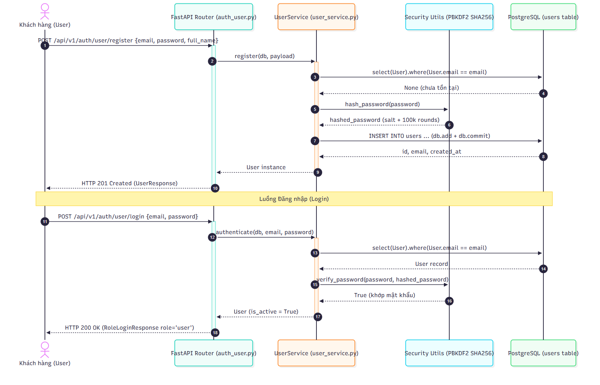

<b>Xem mã nguồn Mermaid</b>

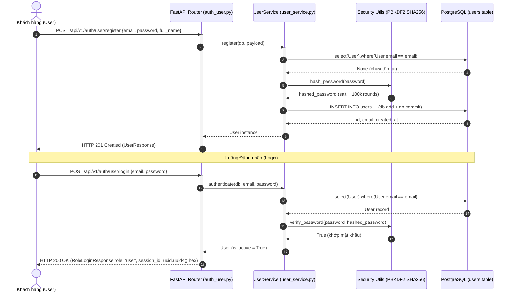

### Diễn giải chi tiết:
1. **Đăng ký:**
   - Client gửi `email`, `password`, `full_name`.
   - `UserService` kiểm tra sự tồn tại của `email` trong bảng `users`. Nếu đã tồn tại -> Trả về `400 Bad Request`.
   - Nếu hợp lệ -> Gọi `security.hash_password` sinh chuỗi muối ngẫu nhiên và băm qua PBKDF2-HMAC-SHA256.
   - Thêm bản ghi vào DB, `commit`, và trả về `UserResponse` (HTTP 201).
2. **Đăng nhập:**
   - Client gửi `email` và `password`.
   - `UserService` tìm user trong DB -> Kiểm tra chuỗi băm bằng `verify_password`. Nếu sai -> Trả về `401 Unauthorized`.
   - Kiểm tra `is_active` -> Trả về `RoleLoginResponse` với thông tin User, `role: "user"` và mã phiên `session_id` (UUID4 hex ngẫu nhiên 32 ký tự).

---

## 3. Luồng 2: Quản trị viên Tạo mới Quán ăn & Tự động sinh tọa độ PostGIS

Áp dụng cho module: `server/app/api/v1/endpoints/restaurants.py` & `server/app/services/restaurant_service.py`.

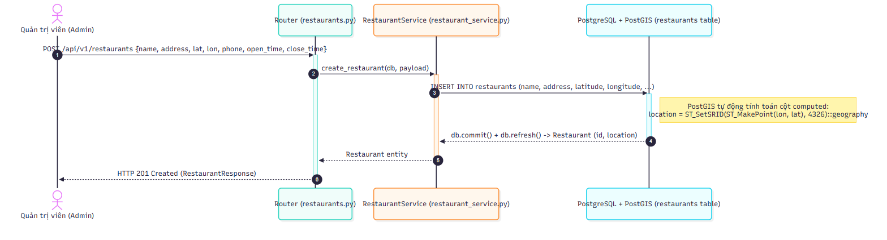

<b>Xem mã nguồn Mermaid</b>

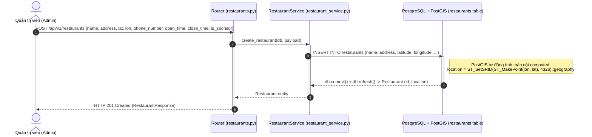

### Diễn giải chi tiết:
1. Quản trị viên gửi thông tin quán kèm tọa độ WGS84 (`latitude`, `longitude`).
2. Router kiểm tra ràng buộc kiểu dữ liệu qua Pydantic schema `RestaurantCreate`.
3. `RestaurantService` khởi tạo bản ghi `Restaurant` trực tiếp.
4. Khi insert vào bảng `restaurants`, engine PostgreSQL + PostGIS tự động kích hoạt biểu thức tính toán lưu trữ:
   $$location = \text{ST\_SetSRID}(\text{ST\_MakePoint}(longitude, latitude), 4326)::\text{geography}$$
5. Quán ăn được tạo thành công, trả về HTTP 201 Created.

---

## 4. Luồng 3: Tìm kiếm Quán ăn Gần đây bằng GPS (Spatial Radius Search)

Áp dụng cho module: `server/app/api/v1/endpoints/restaurants.py` (Endpoint `GET /api/v1/restaurants/nearby`).

<b>Xem mã nguồn Mermaid</b>

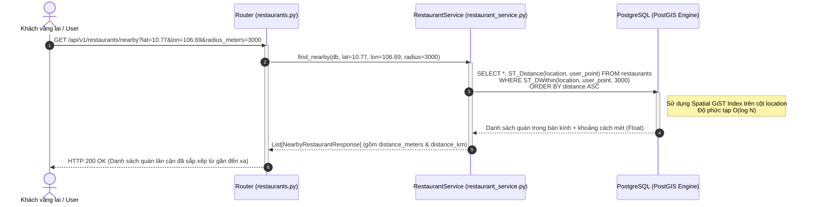

### Diễn giải chi tiết:
1. Khách hàng hoặc khách vãng lai gửi tọa độ hiện tại (`latitude`, `longitude`) kèm bán kính tìm kiếm (mặc định 5000 mét, tối đa 50000 mét).
2. Service khởi tạo điểm vị trí người dùng dưới dạng `Geography POINT(SRID 4326)`.
3. Câu lệnh SQL sử dụng hàm không gian `ST_DWithin` kết hợp **Spatial GiST Index** trên cột `location` để quét nhanh các quán trong bán kính mà không cần quét toàn bộ bảng (table scan).
4. Hàm `ST_Distance` tính toán chính xác khoảng cách trắc địa đường cong mặt cầu (WGS84 ellipsoid).
5. Trả về danh sách quán đã sắp xếp theo khoảng cách tăng dần kèm cả số mét (`distance_meters`) và km (`distance_km`).

---

## 5. Luồng 4: Tra cứu Tọa độ Địa lý qua OpenStreetMap Nominatim

Áp dụng cho module: `server/app/api/v1/endpoints/map.py` & `server/app/services/map_service.py`.

<b>Xem mã nguồn Mermaid</b>

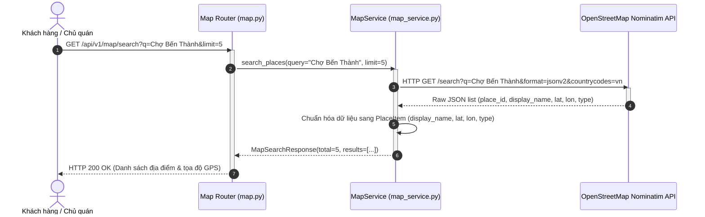

### Diễn giải chi tiết:
1. Client nhập tên địa điểm hoặc đường phố cần tìm.
2. `MapService` thiết lập `User-Agent` hợp lệ theo quy định sử dụng của OpenStreetMap Nominatim.
3. Gửi truy vấn HTTP GET tới endpoint tìm kiếm của Nominatim với giới hạn quốc gia Việt Nam (`countrycodes=vn`).
4. Chuẩn hóa dữ liệu trả về thành cấu trúc DTO sạch gồm: `display_name`, `latitude`, `longitude`, `type`.
5. Trả về kết quả phục vụ hiển thị gợi ý tìm kiếm hoặc tự động điền tọa độ khi chủ quán tạo quán ăn mới.

---

## 6. Luồng 5: Quản trị viên Tạo Món Ăn Mới (Dishes) & Xác Thực Danh Mục, Bữa Ăn

Áp dụng cho module: `server/app/api/v1/endpoints/dishes.py` & `server/app/services/dish_service.py`.

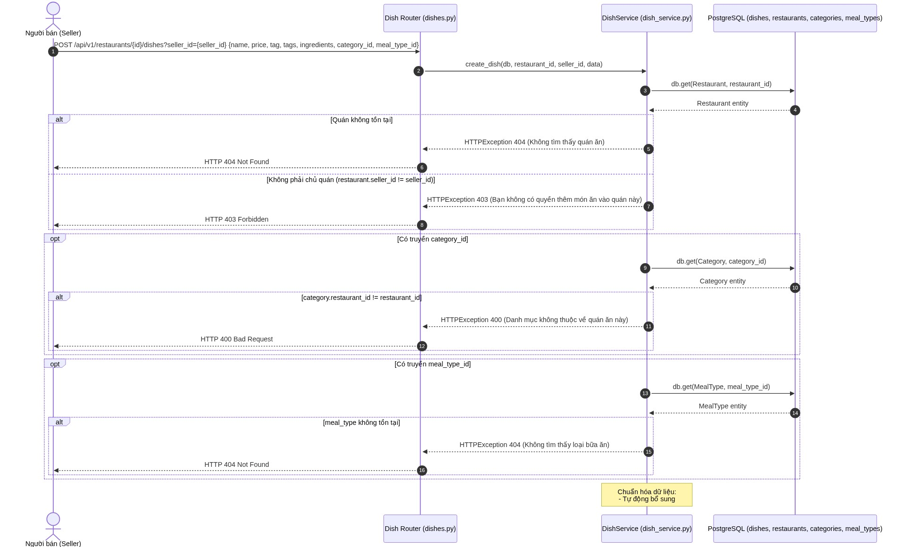

<b>Xem mã nguồn Mermaid</b>

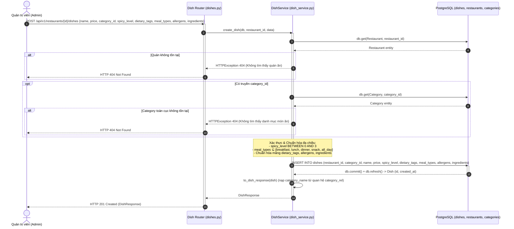

### Diễn giải chi tiết:
1. Quản trị viên gửi yêu cầu tạo món ăn kèm các thông số đa chiều: tên, giá tiền, ID danh mục toàn cục (`category_id`), độ cay (`spicy_level`: 0..3), mảng chế độ ăn (`dietary_tags`), mảng loại bữa ăn (`meal_types`), mảng chất gây dị ứng (`allergens`), và mảng nguyên liệu (`ingredients`).
2. Tầng Controller Pydantic xác thực dữ liệu: `price >= 0`, `spicy_level` từ 0 đến 3.
3. `DishService` thực hiện kiểm tra:
   - Kiểm tra quán ăn tồn tại trong DB.
   - Nếu có `category_id`: kiểm tra danh mục toàn cục tồn tại trong DB (không còn ràng buộc theo quán).
   - Xác thực mảng `meal_types` thuộc tập hợp chuẩn: `breakfast`, `lunch`, `dinner`, `snack`, `all_day`.
4. Thực thi lệnh INSERT vào bảng `dishes`.
5. Trả về `DishResponse` với HTTP 201 Created.

---

## 7. Luồng 6: Khách Hàng Tìm Kiếm & Lọc Thực Đơn Đa Tiêu Chí

Áp dụng cho module: `server/app/api/v1/endpoints/dishes.py` (Endpoint `GET /api/v1/restaurants/{id}/dishes`).

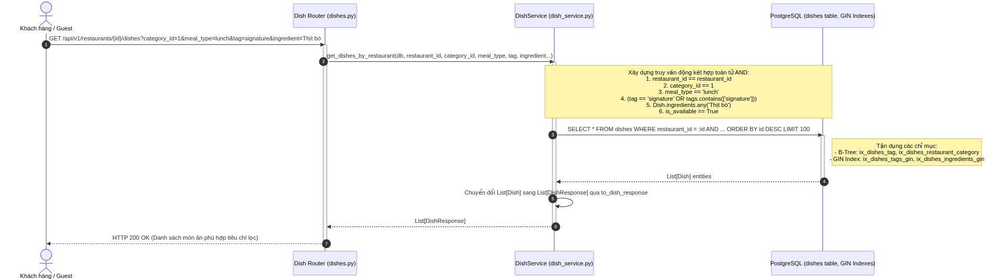

<b>Xem mã nguồn Mermaid</b>

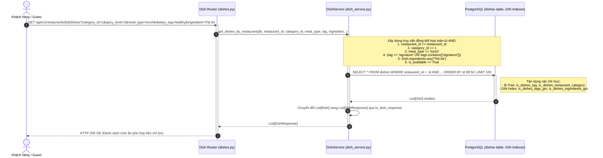

### Diễn giải chi tiết:
1. Client gửi yêu cầu lấy thực đơn của quán kèm các tham số lọc tuỳ chọn: `category_id`, `meal_type_id`, `meal_type`, `tag`, `ingredient`, `available_only`.
2. `DishService` xây dựng câu lệnh truy vấn SQLAlchemy linh hoạt:
   - Bộ lọc `tag`: kiểm tra đồng thời cả cột chuỗi đơn `Dish.tag == t` hoặc mảng `Dish.tags.contains([t])`.
   - Bộ lọc `ingredient`: sử dụng toán tử SQL mảng `Dish.ingredients.any(ingredient)` để tìm món chứa nguyên liệu chỉ định.
   - Kết hợp các điều kiện bằng phép `AND`, chỉ lấy món đang phục vụ (`is_available = True` theo mặc định).
3. PostgreSQL thực thi tối ưu nhờ các chỉ mục GIN trên `tags` và `ingredients`.
4. Trả về mảng danh sách món ăn đã định dạng đầy đủ thông tin cho giao diện người dùng.

---

## 8. Luồng 7: Khách Hàng Quản Lý Món Ăn Yêu Thích (Favourites)

Áp dụng cho module: `server/app/api/v1/endpoints/dishes.py` (Endpoints `/users/{user_id}/favourites`).

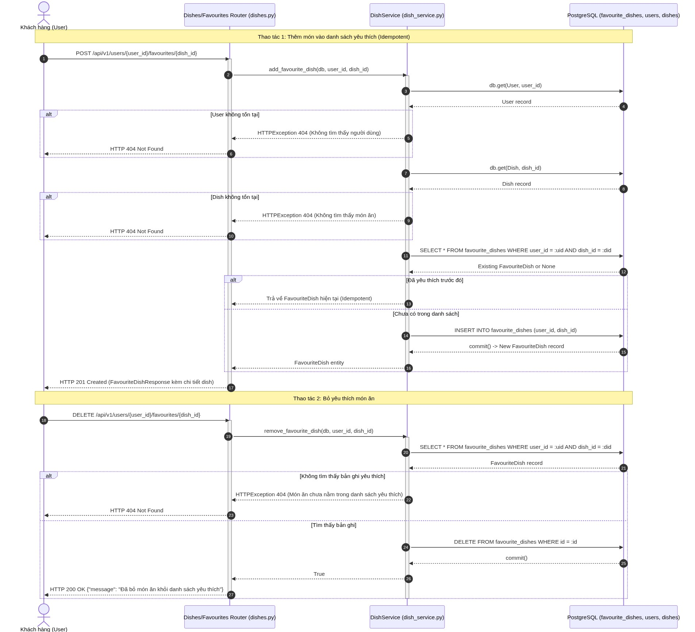

<b>Xem mã nguồn Mermaid</b>

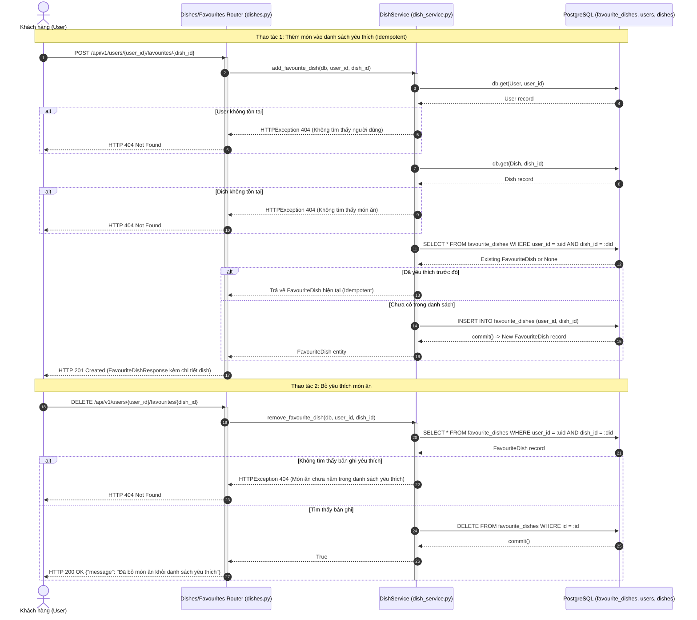

### Diễn giải chi tiết:
1. **Thêm yêu thích (POST):**
   - User gửi `user_id` và `dish_id`.
   - Hệ thống xác minh sự tồn tại của người dùng và món ăn.
   - Cơ chế **Idempotent**: kiểm tra xem cặp `(user_id, dish_id)` đã có trong bảng `favourite_dishes` chưa. Nếu đã có, trả về ngay bản ghi hiện tại mà không báo lỗi hoặc tạo thêm bản ghi trùng.
   - Nếu chưa có, tạo bản ghi mới (không lưu trường `tag` theo đúng thiết kế hiện tại) và trả về HTTP 201 Created.
2. **Bỏ yêu thích (DELETE):**
   - User gửi `user_id` và `dish_id`.
   - Hệ thống tìm và xoá bản ghi khỏi bảng `favourite_dishes`. Nếu không tìm thấy trả về HTTP 404 Not Found.
3. **Cascade Integrity:** Khi món ăn (`Dish`) hoặc tài khoản khách hàng (`User`) bị xoá, toàn bộ các bản ghi `favourite_dishes` liên quan sẽ tự động được xoá theo nhờ cơ chế `ON DELETE CASCADE`.

---

---

## 8. Luồng 8: Quản trị viên Quản lý Danh mục Toàn cục (Global Categories Management)

Áp dụng cho module: `server/app/api/v1/endpoints/categories.py` & `server/app/services/category_service.py`.

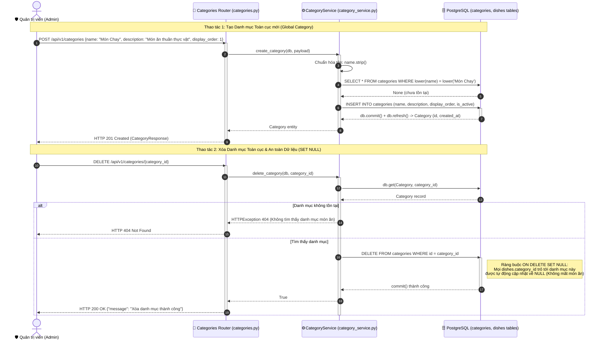

### Diễn giải chi tiết:
1. **Tạo danh mục toàn cục:**
   - Quản trị viên gửi tên danh mục (`name`), mô tả (`description`), thứ tự hiển thị (`display_order`). Không cần cung cấp `restaurant_id`.
   - `CategoryService` kiểm tra ràng buộc duy nhất toàn cục không phân biệt hoa thường (`lower(name)`). Nếu đã tồn tại trả về `400 Bad Request`.
   - Tạo bản ghi và trả về `CategoryResponse` (HTTP 201 Created).
2. **Xóa danh mục an toàn (SET NULL):**
   - Khi xóa danh mục, khóa ngoại `dishes.category_id` tự động nhận giá trị `NULL` nhờ cơ chế `ON DELETE SET NULL`. Toàn bộ món ăn của các quán vẫn được bảo toàn nguyên vẹn trong thực đơn.

---

## 9. Luồng 9: Khảo sát Onboarding & Cập nhật Hồ sơ Sức khỏe / Sở thích (User Profile)

Áp dụng cho module: `mobile/lib/main.dart`, `server/app/api/v1/endpoints/user_profiles.py` & `server/app/services/user_profile_service.py`.

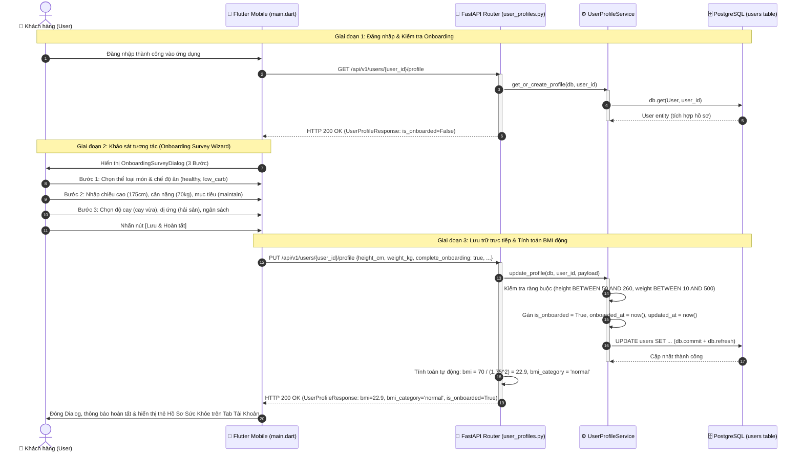

