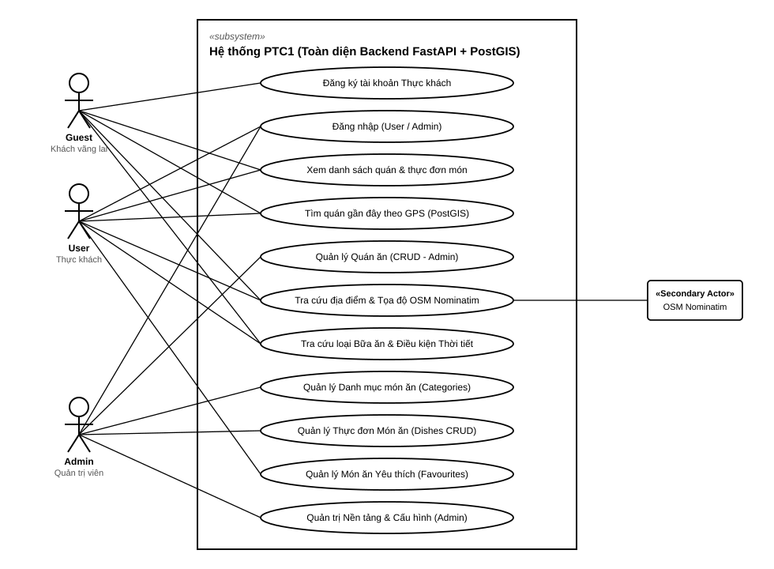
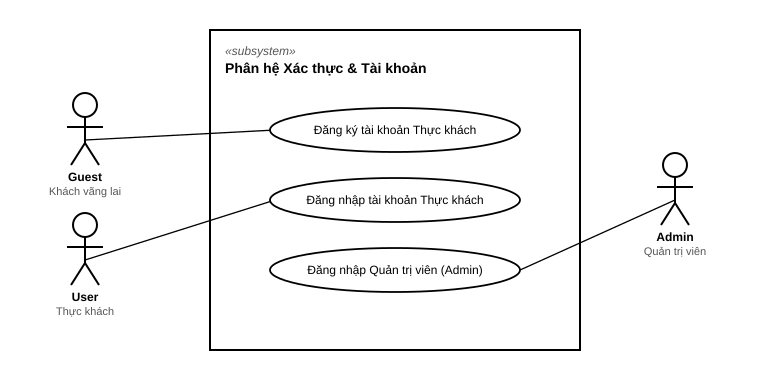
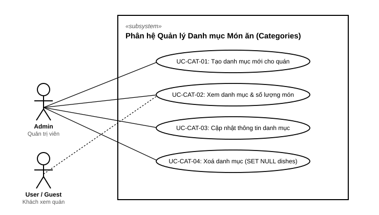
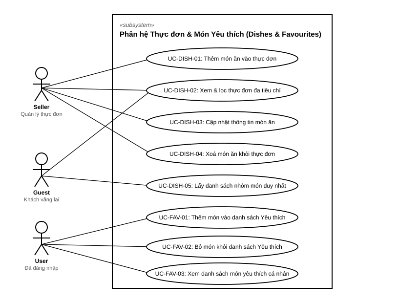
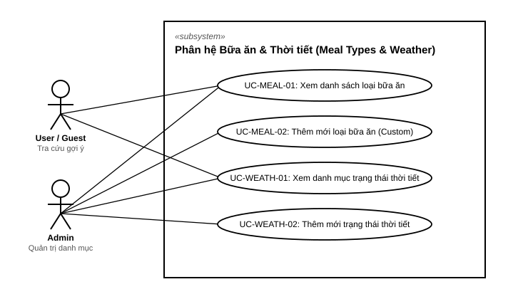
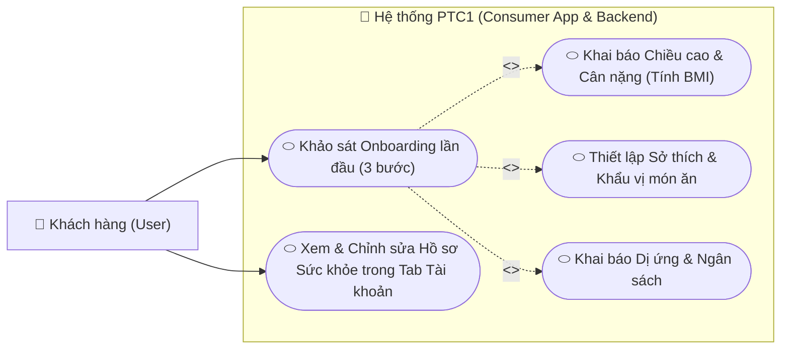

# Tài liệu Đặc tả Use Case: Hệ thống PTC1

> 💡 *Để xem bảng gạch đầu dòng tính năng chi tiết cho Mobile App và Web Admin, vui lòng xem [Danh sách Tính năng (features.md)](features.md)*

Tài liệu này tổng hợp toàn bộ các **Tác nhân (Actors)**, **Sơ đồ Use Case** và **Đặc tả chi tiết từng trường hợp sử dụng (Use Cases)** của hệ thống PTC1, bám sát **100% mã nguồn thực tế hiện có** tại `server/app/`.

---

## 1. Danh sách Tác nhân (Actors)

| Tác nhân (Actor) | Biểu tượng | Mô tả vai trò & Quyền hạn | Lưu trữ DB |
| :--- | :---: | :--- | :--- |
| **Khách vãng lai** *(Guest)* | 🌐 | Người dùng truy cập hệ thống nhưng chưa đăng nhập. Được phép xem danh sách quán, xem chi tiết, tìm quán ăn lân cận theo vị trí GPS và tra cứu địa chỉ bản đồ. | Không lưu trữ trong DB |
| **Khách hàng** *(User)* | 👤 | Người dùng đã đăng ký và đăng nhập tài khoản. Thừa hưởng toàn bộ quyền của Khách vãng lai và có tài khoản định danh để sử dụng các tiện ích cá nhân. | Bảng `users` |
| **Quản trị viên** *(Admin)* | 🛡️ | Quản trị viên hệ thống có cấp bậc quyền hạn (`role_level`), quản trị vận hành nền tảng. | Bảng `admins` |
| **OpenStreetMap Nominatim** | 🗺️ | Hệ thống bản đồ bên thứ 3 cung cấp API Geocoding (chuyển đổi địa chỉ chữ ⇄ tọa độ GPS WGS84). | Dịch vụ ngoài |

---

## 2. Sơ đồ Use Case Chuẩn UML (UML Standard Diagrams)

Các sơ đồ dưới đây được thiết kế theo **chuẩn UML 2.5 quốc tế** (tương tự tài liệu *uml-diagrams.org*):
- 👤 **Người que (Stickman):** Đại diện cho các tác nhân con người (User, Guest, Admin).
- 🔲 **Khung chữ nhật (System Boundary Box):** Đại diện cho ranh giới hệ thống/phân hệ (`<<subsystem>>`).
- ⬭ **Hình elip (Use Case Ellipses):** Đại diện cho từng chức năng/hành động.
- ➖ **Đường nối liên kết (Solid Association Lines):** Biểu diễn mối quan hệ giữa Actor và Use Case.
- 🏢 **Hệ thống ngoài (Secondary Actor):** Nằm bên phải ranh giới hệ thống (OpenStreetMap API).

---

### 2.1. Sơ đồ Use Case Tổng thể (System Overview)

---

### 2.2. Phân hệ 1: Xác thực & Quản lý Tài khoản (Authentication)
Dành cho các tác nhân: **Khách vãng lai (Guest)**, **Khách hàng (User)** và **Quản trị viên (Admin)**.

---

### 2.3. Phân hệ 2: Quản lý Quán ăn dành cho Quản trị viên (Admin Restaurant Management)
Dành cho tác nhân **Quản trị viên (Admin)** thực hiện các thao tác quản lý danh mục và quán ăn trên nền tảng.

---

### 2.4. Phân hệ 3 & 4: Khám phá Quán ăn công khai & Dịch vụ Bản đồ (Public & Map)
Dành cho **Khách vãng lai (Guest)** và **Khách hàng (User)** tra cứu quán ăn, tìm quán gần đây qua PostGIS GPS và tương tác với hệ thống ngoài **OpenStreetMap API**.

---

### 2.5. Phân hệ 5: Quản lý Danh mục Món ăn (Categories)
Dành cho **Quản trị viên (Admin)** tổ chức các nhóm danh mục món ăn cho từng quán và **Khách hàng (User/Guest)** duyệt xem nhóm món.

---

### 2.6. Phân hệ 6: Quản lý Thực đơn Món ăn & Món Yêu thích (Dishes & Favourites)
Dành cho **Quản trị viên (Admin)** quản lý thực đơn món ăn, **Khách hàng (User/Guest)** tìm kiếm/lọc món ăn đa chiều, và **Khách hàng (User)** lưu món yêu thích.

---

### 2.7. Phân hệ 7: Quản lý Bữa ăn & Điều kiện Thời tiết (Meal Types & Weather)
Dành cho **Khách hàng (User/Guest)** tra cứu danh mục bữa ăn & trạng thái thời tiết, và **Quản trị viên (Admin)** quản lý danh mục cấu hình.

---

## 3. Đặc tả chi tiết từng Use Case (Use Case Specifications)

### 3.1. Phân hệ 1: Xác thực & Quản lý Tài khoản (Authentication)

#### UC-AUTH-01: Đăng ký tài khoản User
- **Actor chính:** Khách vãng lai (Guest).
- **Tiền điều kiện:** Email chưa từng được đăng ký trong bảng `users`.
- **Hậu điều kiện:** Bản ghi mới được tạo trong bảng `users` với mật khẩu đã băm PBKDF2-HMAC-SHA256 (100.000 rounds).
- **Luồng chính (Happy Path):**
  1. Người dùng nhập: `email`, `password`, `full_name` (tùy chọn).
  2. Router kiểm tra định dạng email và độ dài mật khẩu (tối thiểu 6 ký tự).
  3. `UserService` kiểm tra email chưa tồn tại trong bảng `users`.
  4. Hệ thống băm mật khẩu với muối ngẫu nhiên qua `security.hash_password`.
  5. Hệ thống lưu tài khoản vào DB và trả về `UserResponse` kèm HTTP 201 Created.
- **Luồng ngoại lệ:**
  - *Email đã tồn tại:* Hệ thống trả về HTTP `400 Bad Request` ("Email này đã được đăng ký tài khoản.").
- **API Endpoint:** `POST /api/v1/auth/user/register`.

#### UC-AUTH-02: Đăng nhập User
- **Actor chính:** Khách hàng (User).
- **Tiền điều kiện:** Tài khoản User đã đăng ký và đang kích hoạt (`is_active = True`).
- **Luồng chính:**
  1. Người dùng gửi `email` và `password`.
  2. `UserService` truy vấn tìm `User` theo email.
  3. Kiểm tra tính trùng khớp của mật khẩu qua `security.verify_password`.
  4. Trả về HTTP `200 OK` với thông tin User và vai trò `role: "user"`.
- **Luồng ngoại lệ:**
  - *Sai email hoặc sai mật khẩu:* Trả về HTTP `401 Unauthorized` ("Email hoặc mật khẩu không chính xác.").
  - *Tài khoản bị khóa (`is_active = False`):* Trả về HTTP `403 Forbidden` ("Tài khoản đã bị vô hiệu hóa.").
- **API Endpoint:** `POST /api/v1/auth/user/login`.

#### UC-AUTH-05: Đăng nhập Admin
- **Actor chính:** Quản trị viên (Admin).
- **Luồng chính:** Xác thực qua bảng `admins`, trả về vai trò `role: "admin"` và cấp độ quyền `role_level`.
- **API Endpoint:** `POST /api/v1/auth/admin/login`.

---

### 3.2. Phân hệ 2: Dịch vụ Bản đồ (Map Services via OpenStreetMap)

#### UC-MAP-01: Tìm kiếm địa điểm theo từ khóa (Forward Geocoding)
- **Actor chính:** Guest, User, Admin.
- **Tiền điều kiện:** Kết nối mạng khả dụng để gọi OpenStreetMap Nominatim API.
- **Luồng chính:**
  1. Người dùng nhập từ khóa tìm kiếm `q` (vd: "Chợ Bến Thành") và giới hạn kết quả `limit` (1-20).
  2. `MapService` gửi request HTTP GET tới OpenStreetMap Nominatim với `format=jsonv2&countrycodes=vn`.
  3. Hệ thống chuẩn hóa danh sách địa điểm sang `PlaceItem` (`display_name`, `latitude`, `longitude`, `type`).
  4. Trả về danh sách gợi ý cho Client (HTTP 200).
- **Luồng ngoại lệ:**
  - *Lỗi mạng hoặc timeout từ Nominatim:* Trả về HTTP `502 Bad Gateway` hoặc mảng rỗng có kiểm soát.
- **API Endpoint:** `GET /api/v1/map/search`.

#### UC-MAP-02: Tra cứu địa chỉ từ tọa độ GPS (Reverse Geocoding)
- **Actor chính:** Guest, User, Admin.
- **Luồng chính:**
  1. Người dùng gửi tọa độ GPS: `latitude`, `longitude`.
  2. Hệ thống kiểm tra tọa độ hợp lệ (-90 <= lat <= 90; -180 <= lon <= 180).
  3. Gọi Nominatim Reverse API và trả về chuỗi địa chỉ chi tiết tương ứng.
- **API Endpoint:** `GET /api/v1/map/reverse`.

---

### 3.3. Phân hệ 3: Khám phá Quán ăn công khai (Public Restaurants)

#### UC-PUB-01: Xem danh sách quán ăn công khai
- **Actor chính:** Khách vãng lai (Guest), Khách hàng (User).
- **Luồng chính:**
  1. Client gửi yêu cầu với tham số phân trang: `skip` (mặc định 0), `limit` (mặc định 20, tối đa 100).
  2. Hệ thống truy vấn các quán có `is_active = True`, sắp xếp `id DESC`.
  3. Trả về danh sách quán ăn (HTTP 200).
- **API Endpoint:** `GET /api/v1/restaurants`.

#### UC-PUB-02: Xem chi tiết thông tin quán ăn
- **Actor chính:** Khách vãng lai (Guest), Khách hàng (User).
- **Luồng chính:**
  1. Client gửi `restaurant_id`.
  2. Hệ thống tìm quán theo ID và đảm bảo `is_active = True`.
  3. Trả về thông tin chi tiết: tên quán, địa chỉ, tọa độ, hotline, mô tả.
- **Luồng ngoại lệ:** Nếu quán không tồn tại hoặc đã bị ẩn -> Trả về HTTP `404 Not Found`.
- **API Endpoint:** `GET /api/v1/restaurants/{restaurant_id}`.

#### UC-PUB-03: Tìm kiếm quán ăn gần đây theo vị trí GPS (Spatial Radius Search)
- **Actor chính:** Khách vãng lai (Guest), Khách hàng (User).
- **Tiền điều kiện:** PostgreSQL đã cài đặt phần mở rộng PostGIS.
- **Luồng chính:**
  1. Client gửi tọa độ hiện tại (`latitude`, `longitude`), bán kính tìm kiếm `radius_meters` (mặc định 5000m, tối đa 50000m) và `limit`.
  2. `RestaurantService` khởi tạo điểm vị trí người dùng dạng PostGIS `Geography POINT(SRID 4326)`.
  3. PostgreSQL sử dụng hàm `ST_DWithin` trên **Spatial GiST Index** của cột `location` để quét nhanh các quán trong bán kính.
  4. Hàm `ST_Distance` tính toán chính xác khoảng cách trắc địa đường cong mặt cầu theo mét.
  5. Sắp xếp danh sách theo khoảng cách từ gần đến xa và trả về `NearbyRestaurantResponse` (kèm `distance_meters` và `distance_km`).
- **API Endpoint:** `GET /api/v1/restaurants/nearby`.

#### UC-PUB-04: Tính khoảng cách từ người dùng tới một quán cụ thể
- **Actor chính:** Khách vãng lai (Guest), Khách hàng (User).
- **Luồng chính:**
  1. Client gửi `restaurant_id`, `user_lat`, `user_lon`.
  2. Hệ thống dùng PostGIS tính khoảng cách thực tế giữa vị trí người dùng và vị trí quán.
  3. Trả về `DistanceResponse` (`distance_meters` và `distance_km` làm tròn 2 chữ số thập phân).
- **API Endpoint:** `GET /api/v1/restaurants/{restaurant_id}/distance`.

---

### 3.4. Phân hệ 4: Quản lý Quán ăn dành cho Quản trị viên (Admin Restaurants Management)

#### UC-REST-01: Tạo mới quán ăn
- **Actor chính:** Quản trị viên (Admin).
- **Luồng chính:**
  1. Admin nhập: `name`, `address`, `latitude`, `longitude`, `phone` (tùy chọn), `description` (tùy chọn), `open_time`, `close_time`.
  2. Router kiểm tra ràng buộc tọa độ WGS84 (-90 <= lat <= 90; -180 <= lon <= 180).
  3. Service insert vào bảng `restaurants`.
  4. PostGIS tự động tính toán cột computed `location` dạng `geography(POINT, 4326)`.
  5. Trả về `RestaurantResponse` kèm HTTP 201 Created.
- **API Endpoint:** `POST /api/v1/restaurants`.

#### UC-REST-02: Cập nhật thông tin quán ăn
- **Actor chính:** Quản trị viên (Admin).
- **Tiền điều kiện:** Quán ăn tồn tại trong hệ thống.
- **Luồng chính:**
  1. Admin gửi thông tin cần cập nhật: `name`, `address`, `latitude`, `longitude`, `phone`, `description`, `open_time`, `close_time`, `is_active`.
  2. Cập nhật các trường và lưu vào DB. Cột `location` PostGIS tự động cập nhật nếu tọa độ thay đổi.
  3. Trả về thông tin quán sau khi cập nhật (HTTP 200).
- **API Endpoint:** `PUT /api/v1/restaurants/{restaurant_id}`.

#### UC-REST-03: Xóa quán ăn
- **Actor chính:** Quản trị viên (Admin).
- **Tiền điều kiện:** Quán ăn tồn tại trong hệ thống.
- **Luồng chính:**
  1. Admin gửi yêu cầu xóa với `restaurant_id`.
  2. Thực hiện xóa bản ghi khỏi bảng `restaurants` (CASCADE tự động dọn dẹp các Category và Dish liên quan).
  3. Trả về HTTP `200 OK` xác nhận xóa thành công.
- **API Endpoint:** `DELETE /api/v1/restaurants/{restaurant_id}`.

---

### 3.5. Phân hệ 5: Quản lý Danh mục Món ăn (Categories Management)

#### UC-CAT-01: Tạo mới nhóm danh mục món ăn cho quán
- **Actor chính:** Quản trị viên (Admin).
- **Tiền điều kiện:** Quán ăn (`restaurant_id`) tồn tại trong hệ thống.
- **Hậu điều kiện:** Bản ghi mới được lưu vào bảng `categories`.
- **Luồng chính:**
  1. Admin gửi thông tin: `restaurant_id` và body JSON `CategoryCreate` (`name`, `description`, `display_order`, `is_active`).
  2. `CategoryService` kiểm tra sự tồn tại của quán ăn.
  3. Chuẩn hóa tên danh mục (strip khoảng trắng thừa).
  4. Kiểm tra ràng buộc duy nhất tên danh mục trong phạm vi quán ăn (`restaurant_id`, `name`).
  5. Thêm bản ghi vào DB, `commit`, và trả về `CategoryResponse` (HTTP 201 Created).
- **Luồng ngoại lệ:**
  - *Quán ăn không tồn tại:* Trả về HTTP `404 Not Found` ("Không tìm thấy quán ăn.").
  - *Trùng tên danh mục trong quán:* Trả về HTTP `400 Bad Request` ("Danh mục món ăn với tên này đã tồn tại trong quán.").
- **API Endpoint:** `POST /api/v1/restaurants/{restaurant_id}/categories`.

#### UC-CAT-02: Xem danh sách các nhóm danh mục của quán ăn
- **Actor chính:** Khách vãng lai (Guest), Khách hàng (User), Quản trị viên (Admin).
- **Luồng chính:**
  1. Client gửi `restaurant_id` kèm query param tuỳ chọn `is_active_only` (mặc định False).
  2. `CategoryService` truy vấn bảng `categories` theo `restaurant_id`, sắp xếp tăng dần theo `display_order`, sau đó theo `id`.
  3. Với mỗi category, hệ thống đếm số lượng món ăn liên kết (`dish_count`) qua quan hệ `dishes`.
  4. Trả về danh sách `List[CategoryResponse]` (HTTP 200 OK).
- **API Endpoint:** `GET /api/v1/restaurants/{restaurant_id}/categories`.

#### UC-CAT-03: Xem chi tiết một danh mục
- **Actor chính:** Guest, User, Admin.
- **Luồng chính:** Client gửi `category_id`. Hệ thống truy vấn bản ghi và trả về thông tin chi tiết kèm `dish_count`.
- **Luồng ngoại lệ:** Nếu không tồn tại -> Trả về HTTP `404 Not Found`.
- **API Endpoint:** `GET /api/v1/categories/{category_id}`.

#### UC-CAT-04: Cập nhật thông tin danh mục món ăn
- **Actor chính:** Quản trị viên (Admin).
- **Tiền điều kiện:** Danh mục tồn tại trong hệ thống.
- **Luồng chính:**
  1. Admin gửi `category_id` và payload cập nhật (`name`, `description`, `display_order`, `is_active`).
  2. Nếu đổi `name`, kiểm tra trùng lặp với các danh mục khác của cùng quán ăn.
  3. Cập nhật và lưu DB. Trả về `CategoryResponse` (HTTP 200 OK).
- **Luồng ngoại lệ:**
  - *Không tìm thấy danh mục:* HTTP `404 Not Found`.
  - *Tên mới bị trùng lặp:* HTTP `400 Bad Request`.
- **API Endpoint:** `PUT /api/v1/categories/{category_id}`.

#### UC-CAT-05: Xóa danh mục
- **Actor chính:** Quản trị viên (Admin).
- **Tiền điều kiện:** Danh mục tồn tại trong hệ thống.
- **Luồng chính:**
  1. Admin gửi yêu cầu xóa với `category_id`.
  2. Xóa danh mục; các món ăn liên quan được giữ nguyên và gán `category_id = NULL` (SET NULL).
  3. Trả về HTTP 200 OK.
- **API Endpoint:** `DELETE /api/v1/categories/{category_id}`.

---

### 3.6. Phân hệ 6: Quản lý Thực đơn Món ăn & Món Yêu thích (Dishes & Favourites)

#### UC-DISH-01: Tạo món ăn mới vào thực đơn quán
- **Actor chính:** Quản trị viên (Admin).
- **Tiền điều kiện:** Quán ăn tồn tại trong hệ thống. Nếu có chỉ định `category_id` thì danh mục đó phải thuộc cùng quán ăn.
- **Hậu điều kiện:** Món ăn mới được tạo trong bảng `dishes`.
- **Luồng chính:**
  1. Admin gửi `restaurant_id` và thông tin món ăn:
     - Bắt buộc: `name`, `price >= 0`.
     - Tuỳ chọn: `description`, `image_url`, `category_id`, `category` (chuỗi), `meal_type_id`, `meal_type` (enum: breakfast, lunch, dinner, snack, all_day), `ingredients` (danh sách nguyên liệu), `is_available`.
  2. Hệ thống kiểm tra quán ăn trong DB.
  3. Nếu có `category_id`, kiểm tra danh mục tồn tại và đảm bảo `category.restaurant_id == restaurant_id`.
  4. Nếu có `meal_type_id`, kiểm tra loại bữa ăn hợp lệ.
  5. Insert vào bảng `dishes`, `commit`, và trả về `DishResponse` (HTTP 201 Created).
- **Luồng ngoại lệ:**
  - *Quán không tồn tại:* HTTP `404 Not Found`.
  - *Giá âm hoặc sai định dạng:* HTTP `422 Unprocessable Entity`.
  - *Category không thuộc cùng quán ăn:* HTTP `400 Bad Request` ("Danh mục không thuộc về quán ăn này.").
- **API Endpoint:** `POST /api/v1/restaurants/{restaurant_id}/dishes`.

#### UC-DISH-02: Xem và lọc thực đơn món ăn của quán
- **Actor chính:** Khách vãng lai (Guest), Khách hàng (User), Quản trị viên (Admin).
- **Luồng chính:**
  1. Client gửi `restaurant_id` kèm các tiêu chí lọc linh hoạt:
     - `category_id`: Lọc theo ID danh mục cụ thể.
     - `category`: Lọc theo tên nhóm món (chuỗi).
     - `meal_type_id`: Lọc theo ID bữa ăn.
     - `meal_type`: Lọc theo bữa ăn (enum).
     - `tag`: Lọc theo nhãn (khớp cột `tag` hoặc phần tử trong mảng `tags`).
     - `ingredient`: Lọc theo nguyên liệu (sử dụng toán tử ANY trên mảng `ingredients`).
     - `available_only`: Chỉ lấy món đang sẵn sàng phục vụ (mặc định True).
     - Phân trang: `skip` (mặc định 0), `limit` (mặc định 100, tối đa 200).
  2. `DishService` dựng câu lệnh truy vấn kết hợp các điều kiện lọc với toán tử AND.
  3. Trả về `List[DishResponse]` (HTTP 200 OK).
- **API Endpoint:** `GET /api/v1/restaurants/{restaurant_id}/dishes`.

#### UC-DISH-03: Lấy danh sách nhóm món duy nhất (Distinct Categories)
- **Actor chính:** Guest, User, Admin.
- **Luồng chính:** Client gửi `restaurant_id`. Hệ thống truy vấn các giá trị `category` không trùng lặp và khác null để phục vụ thanh gợi ý danh mục nhanh.
- **API Endpoint:** `GET /api/v1/restaurants/{restaurant_id}/dish-categories`.

#### UC-DISH-04: Xem thông tin chi tiết một món ăn
- **Actor chính:** Guest, User, Admin.
- **Luồng chính:** Client gửi `dish_id`. Hệ thống truy vấn bản ghi và trả về `DishResponse` đầy đủ thông tin kèm nguyên liệu, tag và bữa ăn.
- **Luồng ngoại lệ:** Nếu không tìm thấy món ăn -> HTTP `404 Not Found`.
- **API Endpoint:** `GET /api/v1/dishes/{dish_id}`.

#### UC-DISH-05: Cập nhật thông tin món ăn
- **Actor chính:** Quản trị viên (Admin).
- **Tiền điều kiện:** Món ăn tồn tại trong hệ thống.
- **Luồng chính:**
  1. Admin gửi `dish_id` và payload cập nhật `DishUpdate`.
  2. Validate `category_id` và `meal_type_id` nếu có cập nhật.
  3. Cập nhật các trường và lưu DB.
  4. Trả về `DishResponse` kèm HTTP 200 OK.
- **Luồng ngoại lệ:**
  - *Món ăn không tồn tại:* HTTP `404 Not Found`.
  - *Danh mục mới không thuộc về quán ăn của món:* HTTP `400 Bad Request`.
- **API Endpoint:** `PUT /api/v1/dishes/{dish_id}`.

#### UC-DISH-06: Xóa món ăn
- **Actor chính:** Quản trị viên (Admin).
- **Tiền điều kiện:** Món ăn tồn tại trong hệ thống.
- **Luồng chính:**
  1. Admin gửi yêu cầu xóa `dish_id`.
  2. Xóa món ăn; các bản ghi yêu thích liên quan bị xóa tự động (CASCADE).
  3. Trả về HTTP 200 OK.
- **API Endpoint:** `DELETE /api/v1/dishes/{dish_id}`.

#### UC-FAV-01: Thêm món ăn vào danh sách yêu thích
- **Actor chính:** Khách hàng đã đăng nhập (User).
- **Tiền điều kiện:** `user_id` và `dish_id` hợp lệ trong DB.
- **Hậu điều kiện:** Bản ghi mới trong bảng `favourite_dishes`.
- **Luồng chính:**
  1. User gửi yêu cầu với `user_id` và `dish_id`.
  2. Hệ thống kiểm tra sự tồn tại của User và Dish.
  3. Kiểm tra trùng lặp: nếu đã yêu thích trước đó, trả về bản ghi hiện tại (Idempotent).
  4. Nếu chưa có -> Tạo bản ghi mới trong `favourite_dishes` (không lưu trường tag).
  5. Trả về `FavouriteDishResponse` kèm thông tin món ăn (HTTP 201 Created).
- **Luồng ngoại lệ:**
  - *User không tồn tại:* HTTP `404 Not Found` ("Không tìm thấy người dùng.").
  - *Món ăn không tồn tại:* HTTP `404 Not Found` ("Không tìm thấy món ăn.").
- **API Endpoint:** `POST /api/v1/users/{user_id}/favourites/{dish_id}`.

#### UC-FAV-02: Bỏ món ăn khỏi danh sách yêu thích
- **Actor chính:** Khách hàng (User).
- **Luồng chính:**
  1. User gửi yêu cầu với `user_id` và `dish_id`.
  2. Hệ thống tìm bản ghi trong bảng `favourite_dishes`.
  3. Nếu tìm thấy, thực hiện xóa khỏi DB và trả về HTTP `200 OK`.
- **Luồng ngoại lệ:** Nếu món ăn chưa từng được yêu thích -> HTTP `404 Not Found`.
- **API Endpoint:** `DELETE /api/v1/users/{user_id}/favourites/{dish_id}`.

#### UC-FAV-03: Xem danh sách món ăn yêu thích cá nhân
- **Actor chính:** Khách hàng (User).
- **Luồng chính:**
  1. User gửi `user_id` kèm phân trang `skip`, `limit`.
  2. Hệ thống kiểm tra sự tồn tại của User và truy vấn danh sách `favourite_dishes` sắp xếp theo thời gian tạo mới nhất (`id DESC`).
  3. Nạp đầy đủ quan hệ món ăn `dish` tương ứng.
  4. Trả về `List[FavouriteDishResponse]` (HTTP 200 OK).
- **API Endpoint:** `GET /api/v1/users/{user_id}/favourites`.

---

### 3.7. Phân hệ 7: Quản lý Bữa ăn & Điều kiện Thời tiết (Meal Types & Weather)

#### UC-MEAL-01: Xem danh sách các loại bữa ăn
- **Actor chính:** Khách vãng lai (Guest), Khách hàng (User), Quản trị viên (Admin).
- **Luồng chính:**
  1. Client gửi yêu cầu lấy danh sách bữa ăn (tùy chọn `active_only=True`).
  2. Hệ thống tự động đảm bảo dữ liệu mặc định đã được khởi tạo (Seed nếu chưa có: Sáng, Trưa, Tối, Ăn vặt, Cả ngày kèm khung giờ).
  3. Trả về danh sách `List[MealTypeResponse]` (HTTP 200 OK).
- **API Endpoint:** `GET /api/v1/meal-types`.

#### UC-MEAL-02: Thêm mới loại bữa ăn tùy chỉnh
- **Actor chính:** Quản trị viên (Admin) / Hệ thống.
- **Luồng chính:**
  1. Gửi payload `MealTypeCreate` (`code`, `name`, `description`, `start_time`, `end_time`, `display_order`).
  2. Kiểm tra tính duy nhất của mã bữa ăn (`code`).
  3. Lưu vào DB và trả về `MealTypeResponse` (HTTP 201 Created).
- **Luồng ngoại lệ:** Trùng mã bữa ăn -> HTTP `400 Bad Request`.
- **API Endpoint:** `POST /api/v1/meal-types`.

#### UC-WEATH-01: Xem danh sách trạng thái thời tiết
- **Actor chính:** Khách vãng lai (Guest), Khách hàng (User).
- **Luồng chính:**
  1. Client gửi yêu cầu truy vấn danh sách trạng thái thời tiết.
  2. Hệ thống tự động seed dữ liệu mặc định (Nắng, Mưa, Se lạnh, Nắng nóng...) nếu chưa có.
  3. Trả về danh sách `List[WeatherResponse]` (HTTP 200 OK).
- **API Endpoint:** `GET /api/v1/weather`.

#### UC-WEATH-02: Thêm mới trạng thái thời tiết
- **Actor chính:** Quản trị viên (Admin) / Hệ thống.
- **Luồng chính:**
  1. Gửi payload `WeatherCreate` (`code`, `name`, `icon`, `temp_min`, `temp_max`, `description`).
  2. Kiểm tra tính duy nhất của mã thời tiết (`code`).
  3. Lưu vào DB và trả về `WeatherResponse` (HTTP 201 Created).
- **Luồng ngoại lệ:** Trùng mã thời tiết -> HTTP `400 Bad Request`.
- **API Endpoint:** `POST /api/v1/weather`.

---

## 4. Ma trận phân quyền chức năng toàn diện (Role-Permission Matrix)

| Phân hệ / Nhóm Chức năng | Khách vãng lai (Guest) | Khách hàng (User) | Quản trị viên (Admin) |
| :--- | :---: | :---: | :---: |
| **Xác thực & Tài khoản:** Đăng ký / Đăng nhập | ✓ | ✓ | ✓ |
| **Bản đồ OSM:** Tìm kiếm địa chỉ & Tọa độ | ✓ | ✓ | ✓ |
| **Quán ăn:** Xem danh sách & Chi tiết quán | ✓ | ✓ | ✓ |
| **Không gian GPS:** Tìm quán gần đây (PostGIS) | ✓ | ✓ | ✓ |
| **Quản lý Quán ăn:** CRUD quán ăn toàn hệ thống | ✗ | ✗ | **✓** |
| **Danh mục (Categories):** Xem danh mục quán | ✓ | ✓ | ✓ |
| **Quản lý Danh mục:** CRUD danh mục cho quán | ✗ | ✗ | **✓** |
| **Thực đơn (Dishes):** Xem & lọc thực đơn đa tiêu chí | ✓ | ✓ | ✓ |
| **Quản lý Thực đơn:** Thêm, sửa, xoá món ăn | ✗ | ✗ | **✓** |
| **Món yêu thích (Favourites):** Thêm / Xoá / Xem yêu thích | ✗ | **✓ (Cá nhân)** | ✗ |
| **Bữa ăn & Thời tiết:** Tra cứu loại bữa ăn & thời tiết | ✓ | ✓ | ✓ |
| **Cấu hình Nền tảng:** Thêm mới MealType & Weather | ✗ | ✗ | **✓** |
| **Quản trị cấp cao:** Vận hành và giám sát nền tảng | ✗ | ✗ | **✓** |

---

### 2.6. Phân hệ 6: Khảo sát Onboarding & Quản lý Hồ sơ Thực khách (User Profile & Dietary Options)
Dành cho tác nhân **Khách hàng (User)** thực hiện khảo sát thể chất (chiều cao, cân nặng, BMI), thiết lập mục tiêu sức khỏe, khẩu vị ăn cay, dị ứng và thể loại món ăn yêu thích.

#### Đặc tả chi tiết Use Case:
- **Tác nhân chính:** Khách hàng (User).
- **Mục tiêu:** Thu thập và lưu trữ thông tin thể trạng (chiều cao, cân nặng, BMI) và sở thích cá nhân hóa (thể loại món, độ cay, chế độ ăn kiêng, dị ứng, ngân sách) để hệ thống phục vụ gợi ý món ăn chuẩn gu.
- **Tiền điều kiện:** Người dùng đã đăng ký và đăng nhập tài khoản Thực khách thành công.
- **Luồng sự kiện chính (Happy Path):**
  1. Sau khi đăng nhập, hệ thống kiểm tra cờ `is_onboarded`. Nếu `false`, mở Onboarding Survey Dialog (3 bước).
  2. Bước 1: Người dùng chọn các thể loại món yêu thích (Phở, Cơm, Lẩu nướng...) và chế độ ăn (Eat clean, Ăn chay, Low-carb...).
  3. Bước 2: Người dùng nhập Chiều cao (cm), Cân nặng (kg), Năm sinh, Giới tính và Mục tiêu dinh dưỡng (Giảm cân, Tăng cơ, Duy trì dáng).
  4. Bước 3: Người dùng chọn Khẩu vị cay (Không cay, Cay vừa, Rất cay), Dị ứng thực phẩm (Hải sản, Đậu phộng...) và Khung ngân sách.
  5. Người dùng nhấn "Lưu & Hoàn tất". Hệ thống gửi request lên Backend API `PUT /api/v1/users/{id}/profile`, tự động tính toán chỉ số BMI và phân loại thể trạng, chuyển cờ `is_onboarded = True`.
  6. Ứng dụng đóng modal và hiển thị thẻ Hồ Sơ Sức Khỏe & Sở Thích trên Tab Tài khoản.
- **Luồng ngoại lệ (Alternative Flows):**
  - Người dùng có thể nhấn "Để sau" để bỏ qua khảo sát lúc mới vào; một banner màu cam sẽ xuất hiện trong tab Tài khoản nhắc nhở khảo sát bất cứ lúc nào.
  - Người dùng có thể nhấn biểu tượng Chỉnh sửa trong tab Tài khoản để cập nhật lại số đo thể chất hoặc sở thích bất kỳ lúc nào.
